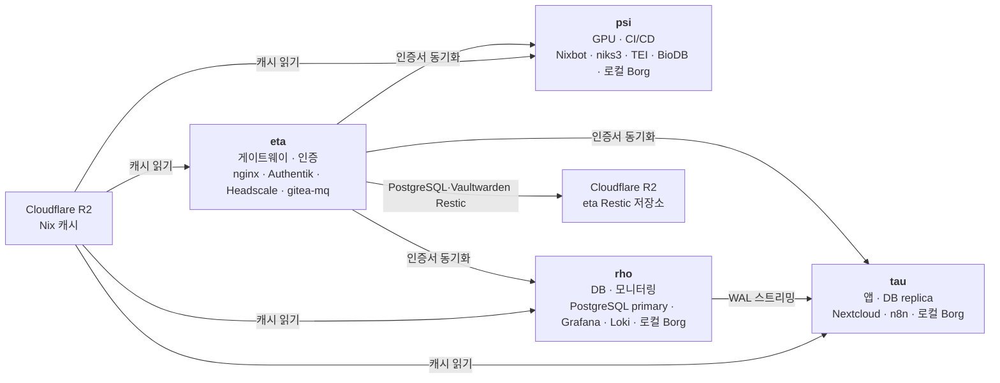
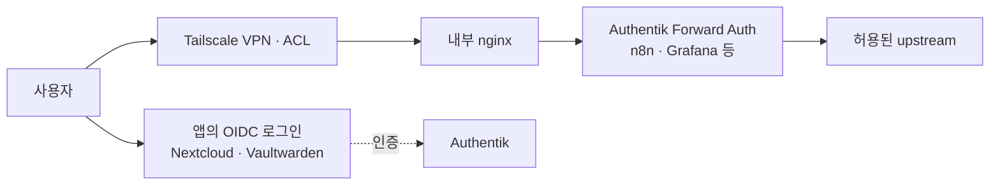

# 아키텍처 개요

## 기술 스택

- **NixOS** + **Flakes** + **flake-parts** — 선언적 시스템 구성
- **sops-nix** (age 암호화) — 시크릿 관리
- **disko** — 선언적 디스크 관리
- **Terraform/Terragrunt** — 외부 리소스 관리 (Cloudflare, GitHub, healthchecks.io, Authentik, Headscale)
- **invoke** (`tasks.py`) — 관리 작업 자동화

## 호스트별 서비스 배치



| 호스트 | 위치 | 주요 서비스 |
|--------|------|------------|
| **eta** | Vultr VPS | nginx 리버스 프록시, Authentik SSO, Headscale VPN, gitea-mq, Vaultwarden, Gatus, Upterm relay, ACME 인증서 |
| **psi** | KREN 베어메탈 | Nixbot+PostgreSQL+nginx/TLS, niks3 control plane, TEI, Apptainer, db-sync, 로컬 Borg; workspace 16TB RAID0, data 30TB usable RAID1 |
| **rho** | 랩 내부 베어메탈 | PostgreSQL primary, Grafana, Prometheus, Loki, Vector, 로컬 Borg; `/srv` 2TB usable RAID1 |
| **tau** | 랩 내부 베어메탈 | Nextcloud, Collabora, n8n, Vaultwarden tailnet proxy, PostgreSQL replica, 로컬 Borg; `/srv` 2TB usable RAID1 |

Docling은 비활성 상태입니다. TEI는 [별도 Naru/WireGuard allowlist](../guide/tei.md)를 사용하며 Headscale 웹 서비스가 아닙니다. 각 bare-metal 호스트의 Borg는 해당 시스템 SSD와 SQL 덤프를 같은 호스트의 HDD에 저장합니다. 홈·workspace·HDD data·live PGDATA는 제외되며 RAID1이나 DB replica가 독립적인 백업을 대신하지 않습니다. eta는 R2 Restic으로 DB·Vaultwarden을 보호합니다. 상세 범위는 [백업](backup.md)을 따릅니다.

호스트별 IP, 네트워크 위치, 방화벽 정책은 [네트워크](network.md)를 참조하세요.

## 인증 흐름



Terraform은 같은 사용자 inventory에서 Authentik 그룹과 Headscale ACL을 구성합니다. Headscale은 VPN 제어 평면이며 사용자 트래픽을 eta로 중계하는 프록시가 아닙니다. Nextcloud는 공개 edge 또는 tailnet으로 접속하고 앱 OIDC로 로그인합니다. 다른 서비스는 네트워크 제한과 서비스별 인증을 함께 적용합니다. 상세는 [인증](authentication.md)과 [네트워크 — ACL](network.md#acl-groups)을 참조하세요.

## 리포지토리 구조

```
flake.nix              # 진입점
configurations.nix     # 호스트 목록
hosts/                 # 호스트별 설정 (.nix) + 시크릿 (.yaml)
modules/               # 서비스 모듈
├── hosts.nix          # 호스트 정의 (IP, MAC, 태그)
├── network.nix        # 네트워크 설정
├── users/             # 사용자 관리
├── <service>/         # 서비스별 모듈 + secrets.yaml
└── ...
terraform/             # Cloudflare, GitHub, Authentik, Headscale, healthchecks.io 리소스
tasks.py               # invoke 관리 명령어
```
