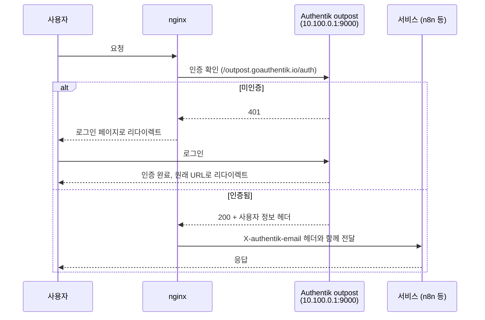

# 인증

## Authentik SSO

`https://auth.sjanglab.org` — 중앙 OIDC/OAuth2 인증 제공자입니다.

### 통합 서비스

| 서비스 | 인증 방식 | 설명 |
|--------|----------|------|
| Headscale | OIDC | VPN 로그인 시 그룹 기반 접근 제어 |
| Nextcloud | OIDC (`user_oidc`) | SSO 로그인 |
| Vaultwarden | OIDC (PKCE) | SSO 로그인 |
| n8n | Forward Auth | 관리자/연구원용 워크플로우 UI (Headscale ACL + Forward Auth 이중 보호) |
| Grafana | Forward Auth | Tailnet에서만 접근 가능한 관리자 대시보드 |
| Gatus | 없음 | Tailnet에서만 접근 가능한 공개 상태 페이지 (Authentik dashboard tile만 표시) |
| Docling | 비활성 | ACL 권한이 있어도 제공되지 않음; [상태 안내](../guide/docling.md) |
| TEI | Naru/WireGuard source allowlist | malt ai-memory embedding과 관리망 모니터링 |
| Nixbot | GitHub OAuth | CI/CD 대시보드 접근 |

### 폐기 서비스의 SSO 객체 정리

서비스를 폐기할 때는 Nix·Terraform 선언과 Authentik UI를 함께 확인합니다. 선언으로 관리하는 객체는 UI에서만 삭제하면 다시 생성되거나 state와 불일치할 수 있습니다. 삭제 범위를 검토하고 승인받은 뒤 다음 순서로 정리합니다.

1. 서비스의 application, provider, outpost 연결과 공유 여부를 확인합니다.
1. 관리 대상 선언·state를 통한 삭제인지 UI 전용 객체 삭제인지 구분합니다.
1. 해당 application의 outpost 연결과 policy·group binding을 제거합니다. 다른 서비스가 사용하는 outpost·policy·mapping은 유지합니다.
1. 해당 application과 전용 provider를 삭제합니다. 전용 outpost·mapping은 다른 참조가 없을 때만 제거합니다.
1. 남은 서비스의 로그인과 접근 제어가 유지되는지 확인합니다.

### Forward Auth 흐름

n8n 등 Forward Auth를 사용하는 서비스의 인증 흐름:

Authentik outpost는 `wg-admin` 인터페이스(포트 9000)에서만 접근 가능합니다.

### 그룹

| 그룹 | 용도 | Headscale ACL 태그 |
|------|------|-------------------|
| `sjanglab-admins` | 전체 접근 권한 | `tag:ai`, `tag:apps`, `tag:monitoring` |
| `sjanglab-researchers` | AI + 앱 접근 | `tag:ai`, `tag:apps` |
| `sjanglab-students` | 앱만 접근 | `tag:apps` |

Authentik 사용자와 그룹 선언은 `terraform/authentik`에서 관리합니다. 사람 계정 목록은 개인정보 보호를 위해 SOPS로 암호화한 `terraform/authentik/users.yaml`에 둡니다. 학생 계정은 `expires_on`을 반드시 지정하고, 만료 후에는 `active: false`로 변경합니다.

Headscale ACL policy는 `terraform/headscale`이 같은 `users.yaml`에서 생성합니다. 비활성 사용자는 Authentik group membership과 Headscale ACL group에서 함께 빠집니다. 상세 매커니즘은 [네트워크 — ACL 정책 관리](network.md#acl-policy)를 참조하세요.
