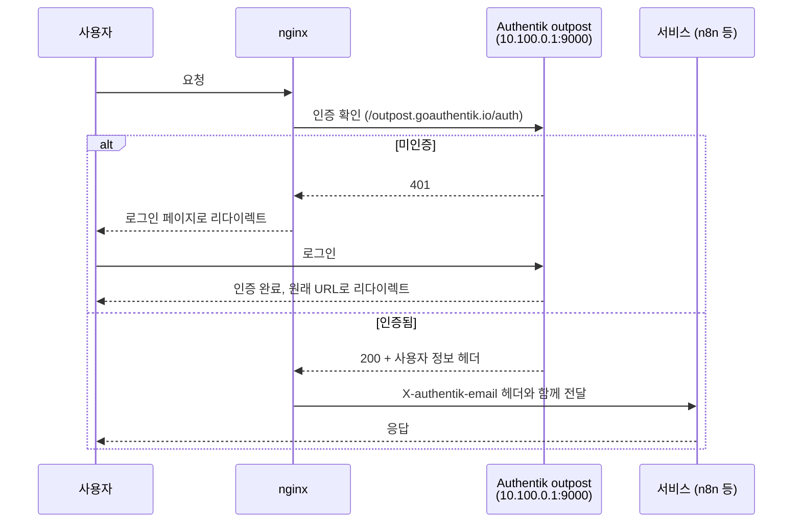

# 인증

## Authentik SSO

`https://auth.sjanglab.org` — 중앙 OIDC/OAuth2 인증 제공자입니다.

### 로그인 수단

사람 계정의 로그인 수단은 Slack 하나입니다. 로그인 화면(`default-authentication-identification` stage)에는 아이디·비밀번호 입력 없이 Slack 버튼만 있습니다. Terraform `terraform/authentik/sources.tf`가 Slack source와 이 stage를 관리합니다.

- Slack source는 Authentik의 범용 OpenID Connect 타입으로 `https://slack.com/.well-known/openid-configuration`을 사용합니다. Authentik의 `slack` 타입은 OIDC scope를 Slack 앱 설치 엔드포인트로 보내 Slack이 거부합니다.
- Slack 앱은 `slack/sjanglab-login/`입니다. 로그인 전용이며 bot이 없습니다.
- 사용자는 Slack member id(`U…`)로 식별합니다. Slack source에 연결(connection)이 있는 계정만 로그인할 수 있고, 연결 없는 Slack 계정은 거부됩니다.

### 비상 접근 (break-glass) { #break-glass }

Slack 장애나 source 설정 오류로 아무도 로그인할 수 없을 때 사용합니다. 복구 링크는 로그인 흐름을 거치지 않고 바로 로그인시키며, 한 번 쓰면 사라집니다.

```bash
ssh eta
sudo ak create_recovery_key 5 akadmin    # 유효 시간은 분 단위
```

출력된 링크를 시크릿 창에서 열고, 작업이 끝나면 창을 닫습니다. 링크는 관리자 권한 그 자체이므로 채팅·이슈·로그에 붙여넣지 않습니다. Terraform용 API 토큰(`terraform/authentik/secrets.yaml`의 `AUTHENTIK_TOKEN`)도 로그인 흐름과 무관하게 동작합니다.

### 통합 서비스

| 서비스 | 인증 방식 | 설명 |
|--------|----------|------|
| Headscale | OIDC | VPN 로그인 시 그룹 기반 접근 제어 |
| Nextcloud | OIDC (`user_oidc`) | SSO 로그인 |
| Vaultwarden | OIDC (PKCE) | SSO 로그인 |
| n8n | Forward Auth | 관리자/연구원용 워크플로우 UI (Headscale ACL + Forward Auth 이중 보호) |
| Grafana | Forward Auth | 공개 HTTPS + `sjanglab-admins` 인가; 신규 Grafana 계정은 Viewer |
| Gatus | Forward Auth | 공개 HTTPS + 구성원(admins·researchers·students) 인가 상태 페이지 |
| Nixbot | GitHub OAuth | CI/CD 대시보드 접근 |

### 폐기 서비스의 SSO 객체 정리

서비스를 폐기할 때는 Nix·Terraform 선언과 Authentik UI를 함께 확인합니다. 선언으로 관리하는 객체는 UI에서만 삭제하면 다시 생성되거나 state와 불일치할 수 있습니다. 삭제 범위를 검토하고 승인받은 뒤 다음 순서로 정리합니다.

1. 서비스의 application, provider, outpost 연결과 공유 여부를 확인합니다.
1. 관리 대상 선언·state를 통한 삭제인지 UI 전용 객체 삭제인지 구분합니다.
1. 해당 application의 outpost 연결과 policy·group binding을 제거합니다. 다른 서비스가 사용하는 outpost·policy·mapping은 유지합니다.
1. 해당 application과 전용 provider를 삭제합니다. 전용 outpost·mapping은 다른 참조가 없을 때만 제거합니다.
1. 남은 서비스의 로그인과 접근 제어가 유지되는지 확인합니다.

### Forward Auth 흐름

n8n 등 Forward Auth를 사용하는 서비스의 인증 흐름:



Authentik outpost는 `wg-admin` 인터페이스(포트 9000)에서만 접근 가능합니다.

### 그룹

| 그룹 | 용도 | Headscale ACL 태그 |
|------|------|-------------------|
| `sjanglab-admins` | 전체 접근 권한 | `tag:ai`, `tag:apps`, `tag:monitoring` |
| `sjanglab-researchers` | 앱 + n8n·Neko | `tag:apps` (member) |
| `sjanglab-students` | 앱 | `tag:apps` (member) |
| `sjanglab-staff` | 행정 업무: Nextcloud, Vaultwarden, quorum | VPN 없음 |
| `sjanglab-pending` | 승인 대기. 어떤 앱에도 접근하지 않음 | VPN 없음 |

앱 접근은 앱마다 붙은 그룹 binding으로 정하며, 목록은 `terraform/authentik/access.tf`의 `app_groups`에 있습니다. UI의 앱 화면에서 허용 그룹을 볼 수 있지만, binding 자체는 UI에서 바꾸지 않습니다. 그룹이 없거나 `sjanglab-pending`뿐인 계정은 로그인해도 쓸 수 있는 앱이 없습니다.

researchers, students, staff의 멤버는 같은 이름의 Slack user group을 eta의 `slack-group-sync`가 반영한 것입니다. admins는 동기화하지 않습니다. 절차는 [사용자 관리](user-management.md)를 참조하세요.

그룹, 앱 접근 binding, 앱, source, flow와 서비스 계정(`akadmin`, `terraform`)은 `terraform/authentik`에서 관리합니다. 사람 계정과 그룹 membership은 Authentik UI에서 관리하며 Terraform은 다루지 않습니다. quorum의 채널 범위 claim(`slack_user_id`)은 사용자의 Slack 연결에서 읽습니다.

Headscale ACL에는 관리자 목록만 있고, 나머지는 `autogroup:member`입니다. VPN 로그인 인가는 Headscale OIDC `allowed_groups`가 Authentik 그룹으로 판단합니다. 상세 매커니즘은 [네트워크 — ACL 정책 관리](network.md#acl-policy)를 참조하세요.
