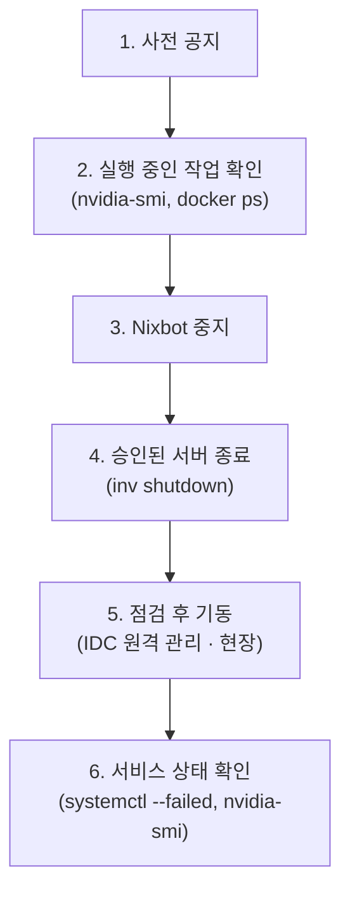

# 데이터센터

## 서버 물리적 위치

| 호스트 | 위치 | 네트워크 | 물리 접근 |
|--------|------|----------|----------|
| **rho** | 랩 내부 | 10.80.169.39 (NAT) | 직접 가능 |
| **tau** | 랩 내부 | 10.80.169.40 (NAT) | 직접 가능 |
| **psi** | INU IDC (별도 서버실) | 117.16.251.37 (공인 IP) | 사전 연락 필요 |
| **eta** | Vultr VPS | 141.164.53.203 (공인 IP) | 물리 접근 불가 |

## 유지보수 책임

| 작업 | 담당 | 비고 |
|------|------|------|
| 하드웨어 점검 (디스크, 네트워크, 전원) | 관리자 | root 권한 필요 |
| 서버 전원 관리 (`inv wake/shutdown/reboot`) | 관리자 | 관리 워크스테이션에서 실행 |
| WireGuard/네트워크 진단 | 관리자 | sudo 필요 (관리자만 `wheel` 그룹) |
| NixOS 배포 | 관리자 | `inv deploy` |
| 물리 서버 확인/케이블 점검 | 관리자 | rho/tau는 랩 내, psi는 IDC |
| 소프트웨어 문제 보고 | 개발자 | 관리자에게 보고 |

> 연구원/학생은 sudo 권한이 없습니다 (`wheel` 그룹 미포함). 하드웨어 진단, 네트워크 설정, 전원 관리는 관리자만 수행할 수 있습니다.

## 전원 관리

### Wake-on-LAN

```bash
inv wake --host rho
inv wake --host tau
```

`inv wake`는 WoL 매직 패킷을 전송하며 \*\*같은 L2 네트워크(랩 내부)\*\*에서만 동작합니다.

| 호스트 | `inv wake` 가능 여부 | 비고 |
|--------|---------------------|------|
| rho | O (랩 내부에서만) | 랩 네트워크 브로드캐스트 |
| tau | O (랩 내부에서만) | 랩 네트워크 브로드캐스트 |
| psi | X | 승인된 IDC 원격 관리 수단 또는 현장 수동 기동 |
| eta | X | Vultr 콘솔에서 수동 기동 |

### 종료/재부팅

```bash
inv shutdown --host <host>
inv reboot --host <host>
```

## 하드웨어 점검

관리자 SSH alias와 eta ProxyJump를 먼저 설정합니다. psi·rho·tau는 공개 SSH를 수신하지 않으며 [SSH 접속](../dev/ssh-access.md) 경로를 따릅니다. 읽기 권한이 필요한 명령에만 `sudo`를 사용합니다.

### 디스크 상태

```bash
ssh rho 'ls -l /dev/disk/by-id/'
ssh rho 'sudo smartctl -a /dev/disk/by-id/<disk-id>'
ssh rho 'df -h; cat /proc/mdstat; findmnt /srv'
ssh psi 'df -h; cat /proc/mdstat; findmnt --target /workspace; findmnt --target /data'
```

### 네트워크

```bash
# Inspect transport from an approved administrator account
ssh rho 'sudo wg show wg-admin'
ssh rho 'tailscale status'
```

## psi GPU 냉각수 점검

psi 서버는 **분기별 1회 (연 4회)** GPU 냉각수 점검을 받습니다. IDC 업체에서 사전에 연락이 오며, **서버를 꺼야 하는 경우에만 별도 요청**이 옵니다. 연락이 없으면 서버를 끄지 않아도 됩니다.

### 정리 절차 (서버 종료가 필요한 경우)



**1단계 — 사전 공지**: 사용자에게 점검 일정과 종료 시간을 안내합니다.

**2단계 — 실행 중인 작업 확인**:

```bash
ssh psi nvidia-smi
ssh psi docker ps
```

**3단계 — 작업 drain과 Nixbot 중지**: 새 작업 유입을 제한하고 실행 중인 빌드·연구 작업의 완료 또는 승인된 중단을 확인합니다. service stop은 기존 작업을 안전하게 완료시키는 drain의 대체가 아닙니다.

```bash
ssh psi sudo systemctl stop nixbot
```

**4단계 — 서버 종료**:

```bash
inv shutdown --host psi
```

**5단계 — 점검 완료 후 복구**: IDC 업체와 협의한 원격 관리 또는 현장 절차로 기동합니다. 접근 수단과 담당자를 종료 전에 확보합니다.

**6단계 — 서비스 상태 확인**:

```bash
ssh psi systemctl --failed
ssh psi nvidia-smi
ssh psi 'cat /proc/mdstat; findmnt --target /workspace; findmnt --target /data'
ssh psi 'systemctl status nixbot borgbackup-job-local.timer borgbackup-verify-local.timer'
```

## 비상 시 대처

### 전원 차단

1. 네트워크 장애와 호스트 정지를 구분하고 콘솔·승인된 원격 관리 수단으로 상태를 확인합니다. 정상 종료를 우선하며 강제 전원 차단은 데이터 손상 위험을 검토하고 승인받은 최후 수단으로만 사용합니다
1. 전원 복구 후:
   - rho/tau: 랩 내부에서 `inv wake --host <host>`
   - psi: 승인된 IDC 원격 관리 또는 현장 수동 기동
   - eta: Vultr 콘솔에서 기동
1. 기동 후 서비스 상태를 확인합니다: `systemctl --failed`

### 네트워크 장애

1. eta의 공개 bastion `jump.sjanglab.org:10022`와 호스트의 wg-admin 연결을 구분해 확인합니다. psi는 공인 IP가 있어도 공개 SSH를 수신하지 않습니다.
1. wg-admin 경로가 복구되지 않으면 rho/tau는 현장 콘솔, psi는 승인된 IDC 콘솔·현장 접근을 사용합니다. 장애 대응을 위해 공개 SSH나 방화벽 우회를 임의 추가하지 않습니다.
1. `wg-admin` 복구 후 `wg show wg-admin`으로 피어 상태를 확인합니다

## 물리 접근 시 주의사항

- 서버 전원 케이블을 분리하기 전에 반드시 `inv shutdown`으로 정상 종료합니다
- 디스크 교체 시 by-id 식별자·현재 RAID 상태·disko 선언을 대조합니다. psi workspace만 RAID0이며 HDD data와 rho/tau `/srv`는 RAID1입니다. 장치명 추정이나 재포맷으로 장애를 우회하지 않습니다.
- 재기동 후 서비스·RAID·마운트·백업 타이머·GPU와 기존 유지보수 hold를 확인합니다. 승인 없이 자동 업데이트/재부팅 hold나 `observe` 모드를 변경하지 않습니다.
- 네트워크 케이블 변경 시 IP/게이트웨이 설정을 `modules/hosts.nix`와 대조합니다
