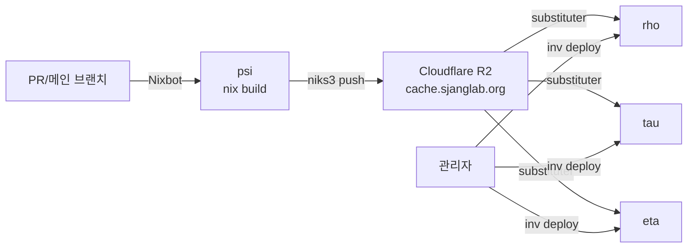

# 배포 & 변경 관리

## 수동 배포

```bash
# 단일 호스트
inv deploy --hosts psi

# 다중 호스트
inv deploy --hosts psi,rho,tau,eta
```

배포는 별도 승인받은 호스트만 대상으로 합니다. `inv deploy`는 로컬 flake를 `nix flake archive --to ssh://<host>`로 전달한 뒤 원격 호스트에서 `sudo nixos-rebuild switch`를 실행합니다. 빌드 성공만으로 서비스 정상 동작을 판정하지 않습니다.

## 자동 업그레이드

모든 호스트에 자동 업그레이드가 설정되어 있습니다:

- **소스**: `github:SBEE-lab/infra`
- **업그레이드 체크**: `system.autoUpgrade`가 매일 04:40 KST에 최신 커밋을 가져와 `nixos-rebuild switch` 실행
- **재부팅 체크**: 매월 마지막 토요일에 `auto-reboot` 서비스가 커널 업데이트 여부를 확인
- **재부팅**: 커널이 변경된 경우에만 24시간 후 자동 재부팅 (`shutdown -r +1440`)
- **재부팅 지터**: 최대 20분 지연 (호스트별 시점 분산)

보수용 runtime/영구 drop-in이 있으면 선언된 타이머도 실행이 차단될 수 있습니다. Git의 선언만 보고 해제 상태를 추정하지 않습니다. [자동 업데이트 차단 확인·해제](monitoring.md)를 따르며, 일반 배포만으로 영구 hold가 제거되거나 marker를 만들어도 된다는 뜻은 아닙니다.

## 사전 빌드 (Nixbot/niks3 캐시)

PR과 메인 브랜치 변경은 Nixbot이 빌드합니다. 성공한 결과는 niks3가 추적하고 Cloudflare R2에 저장합니다. 다른 호스트는 배포 시 `https://cache.sjanglab.org` substituter에서 이미 빌드된 결과를 가져옵니다.



일반적인 배포 흐름은 **PR 리뷰·Nixbot 확인 → gitea-mq batch 검증·병합 → 승인된 호스트 배포 → 런타임 점검**입니다.

## 배포 전 확인

```bash
# Evaluate the target; let native CI build Linux host toplevels
nix eval --raw .#nixosConfigurations.psi.config.system.build.toplevel.drvPath
nix fmt
inv docs-linkcheck
```

macOS에서는 routine Linux system toplevel 빌드보다 평가와 native CI를 우선합니다. 필요한 개별 테스트는 `.#checks.x86_64-linux.<check>`로 지정합니다. CI 전체를 확인하고 rollback generation·접속 경로·secret 전달·디스크 마운트가 유지되는지 검토합니다.

배포 후 해당 systemd unit·실제 listener·방화벽 도달성·메트릭·사용자 endpoint를 확인합니다. 경로 장애로 관측이 누락되면 정상으로 판정하지 않습니다. 자동 업데이트·재부팅 hold와 `observe` 모드는 배포와 별개로 승인·검증한 뒤 변경합니다.

## 주요 invoke 명령어

| 명령어 | 설명 |
|--------|------|
| `inv deploy --hosts <host>` | 원격 배포 |
| `inv add-server --hostname <name>` | 새 서버 추가 |
| `inv generate-ssh-cert <host> [--aliases <dns,...>]` | SSH 인증서 생성. eta 재발급 시 `--aliases jump.sjanglab.org` 지정 |
| `inv generate-wireguard-key --hostname <host>` | WireGuard 키 생성 |
| `inv generate-password --user <name>` | 비밀번호 해시 생성 |
| `inv update-host-info [--hosts <host,...>]` | 호스트 하드웨어 보고서 갱신 |
| `inv update-lldp-info [--hosts <host,...>]` | LLDP 네트워크 그래프 갱신 |
| `inv update-network-topology` | NixOS 설정에서 논리 네트워크 토폴로지 갱신 |
| `inv expired-accounts` | 만료 계정 확인 |
