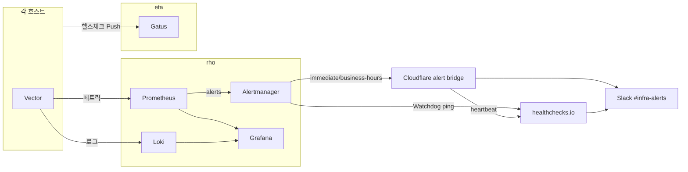

# 모니터링

## 운영 모드

공통 설정은 현재 `active`입니다. 수집·대시보드·Prometheus 규칙 평가를 유지하며 명시적으로 분류된 operational alert를 Slack bridge로 전송하고 Watchdog은 healthchecks.io로 직접 보냅니다. 미분류 알림은 discard 처리합니다. `observe`는 수집·평가를 유지하면서 외부 전송을 중단하고, `paused`는 수집·평가도 중단합니다. 모드 전환과 실제 알림·복구 전송 테스트는 별도 승인 대상입니다.

`active`에서는 즉시 대응과 업무시간 대응을 구분합니다. 업무시간은 평일 09:00–18:00 Asia/Seoul이며 공휴일 예외나 요약 발송은 없습니다. 아래 알림 연결도는 활성 모드의 경로입니다. 설정만으로 전달 성공을 판정하지 않고 실제 수신을 확인합니다.

### 보수 중 자동 업데이트 차단

자동 업데이트 차단 여부는 각 호스트에서 `systemctl cat auto-upgrade.service auto-upgrade.timer auto-reboot.service auto-reboot.timer`로 확인합니다. 런타임 drop-in의 존재를 Git 선언만으로 추정하지 않습니다.

`/etc/systemd/system.control/{auto-upgrade,auto-reboot}.{service,timer}.d/90-migration-pause.conf`가 있으면 재부팅과 일반 Nix 배포 후에도 차단될 수 있습니다. `/run/systemd/system/`의 동일 이름 drop-in도 확인합니다. `/run/infra-maintenance-resume-automatic-updates` marker 생성으로 실행 조건을 우회하지 않습니다.

차단 해제는 변경 검토·배포·운영 검증을 마친 뒤 별도 승인으로 수행합니다. 해당 drop-in을 제거하고 daemon reload·timer 재활성화 후 다음 실행 시각과 실제 적용 상태를 확인합니다.

## 대시보드

- **Grafana**: `https://logging.sjanglab.org` (Authentik Forward Auth, localhost upstream, 신규 인증 사용자 Viewer)
  - `SjangLab Infrastructure` (홈): 발화 중 알림, 침해 징후, 즉시 등급 서비스 장애, 백업 경과, Gatus 실패 수
  - `SjangLab Access & Audit`: 맨 위 침해 징후(평소 0)·로그인 출처·공격 압력, 아래 접힌 SSH/tailnet/Authentik/Headscale drilldown
  - `SjangLab Public Edge`: eta 공개 vhost 트래픽, 스캐너 경로, 큰 요청 본문, 5xx, 민감 경로 응답
  - `SjangLab Hosts`: 호스트 리소스, 데이터 파일시스템, SMART·NVMe·RAID, auto-upgrade 결과, Headscale 노드 상태
  - `SjangLab Apps`: Gatus 내부 체크와 Blackbox 외부 probe 비교, Nextcloud PHP-FPM·5xx·경고 로그
  - `SjangLab Jobs`: Borg 백업·무결성 검사와 PostgreSQL 덤프의 마지막 완료 기록
  - `SjangLab AI Resources`: AI 서비스 smoke, psi 리소스, 데이터 동기화 상태
  - `SjangLab PostgreSQL`: rho primary, tau replica, streaming lag, slot WAL 여유, replication 감사 이력
- **Gatus**: `https://status.sjanglab.org` (eta 공개 HTTPS + Authentik 구성원 인증 상태 페이지)
  - PostgreSQL은 `primary rho`와 `replica tau`를 별도 endpoint로 표시합니다.

## Grafana 사용 순서

1. [Grafana](https://logging.sjanglab.org)에 접속해 Authentik으로 로그인합니다. 공개 HTTPS 경로는 VPN이 필요 없으며 기존 `sjanglab-admins` 인가 정책을 유지합니다. 신규 사용자는 Viewer이며 공유 관리자 계정이나 별도 API 토큰이 필요하지 않습니다. 접근 거부는 Authentik 인가·그룹을 확인하고, 헤더 위조나 인증 우회로 해결하지 않습니다.
1. 우측 상단 시간 범위를 평소에는 최근 6시간, 야간 작업 점검에는 최근 24시간으로 선택합니다. 패널이 비어 있으면 기간을 늘리고 수집 상태부터 확인합니다. `No data`를 성공이나 0건으로 해석하지 않습니다.
1. [Hosts](https://logging.sjanglab.org/d/sjanglab-hosts)에서 `Metrics freshness`, `Prometheus targets`, 디스크·CPU·메모리를 먼저 봅니다. 수집 경로가 끊긴 상태에서 다른 패널의 과거 값을 현재 상태로 판정하지 않습니다.
1. [Jobs](https://logging.sjanglab.org/d/sjanglab-jobs)에서 `Latest recorded outcome`과 `Last completion time`을 함께 봅니다. `Success`만으로 예약 실행·무결성·복원을 판정하지 않습니다.
1. 앱 장애는 [Apps](https://logging.sjanglab.org/d/sjanglab-apps), DB 복제는 [PostgreSQL](https://logging.sjanglab.org/d/sjanglab-postgresql), 로그인·권한 문제는 [Access & Audit](https://logging.sjanglab.org/d/sjanglab-access-audit)에서 같은 시간대를 확인합니다.

공개 경로는 eta nginx → rho nginx → localhost Grafana입니다. eta는 rho 인증서의 CA·hostname을 검증하고 외부에서 받은 identity 헤더를 버립니다. 교차 서명된 중간 CA 체인을 허용하도록 TLS 검증 깊이는 4로 설정합니다. 502가 발생하면 실제 upstream 인증서 체인을 확인하며 인증서 검증을 끄지 않습니다. rho가 Authentik 인가 후 identity를 다시 설정하며, 클라이언트 주소 헤더도 eta peer에서 온 경우에만 신뢰합니다. 익명 접근은 끄고 신규 Grafana 계정 기본 역할은 Viewer로 유지합니다. Viewer도 데이터소스 조회가 가능하므로 SSO 접근 그룹을 확대할 때 로그 열람 범위를 함께 검토합니다.

Headscale split DNS는 내부 rho 경로를 유지합니다. `/prometheus/`와 `/alertmanager/`는 공개 eta 경로에서 404이며, 내부 경로 또는 SSH 터널을 사용합니다. Grafana의 자체 `/api/`·WebSocket은 인증 뒤에 제공하며 직접 Prometheus/Loki API를 공개하는 설정이 아닙니다.

공개 경로 변경은 `terraform/dns`의 `logging.sjanglab.org` 레코드와 eta·rho 설정을 함께 적용해야 합니다. rho의 인증·헤더 신뢰 설정을 먼저 적용하고, eta의 public ACME 발급·rho 인증서 동기화를 확인한 뒤 공개 접속을 검증합니다. 선언 추가나 기존 인증서 파일만으로 적용 완료를 판정하지 않습니다. 검증 기준은 VPN 없는 접속의 로그인 유도, 승인 사용자 dashboard·Live 연결, identity 헤더 위조 거부, public 관리 경로 404, 내부 관리 경로 유지입니다. public DNS를 추가해 HTTP-01 발급을 시작하기 전에는 기존 DNS-01 인증서를 제거하지 않습니다.

인증서 동기화에서 `failed to set times`가 발생하면 rho의 수신 디렉토리와 파일·심볼릭 링크 자체의 소유권을 수신 계정 `acme-sync-logging`과 비교합니다. 링크 소유권 수정에는 `chown -h`를 사용해 대상을 따라가지 않으며, 개인키·인증서 본문을 로그에 출력하지 않습니다. 동기화 서비스 정상 종료와 nginx reload까지 확인합니다.

### Access & Audit 패널 판독

`SSH Access audit`와 `Tailnet app access`는 원본 SSH·nginx 로그가 아니라 rho의 두 correlator가 가공한 기록입니다. `observe`에서도 수집하며 timer 활성화 60초 뒤 첫 실행, 이후 60초 간격으로 실행합니다. `active (elapsed)`이면서 다음 실행이 없으면 정상 수집 상태가 아닙니다. 다음 trigger, 최근 서비스 완료, `correlator_heartbeat`와 원본 로그를 함께 확인합니다. 수집 재개만으로 과거 공백이 자동 복구되지는 않습니다. 공개 Grafana 요청은 tailnet audit 대상이 아니며 원본 `nginx_access`에서 확인합니다.

### Jobs 패널 판독

| 표시 | 의미 | 추가 확인 |
|------|------|----------|
| `Success` | 마지막으로 기록한 실행이 정상 종료 | 완료 시각이 충분히 최근인지 확인 |
| `Unsuccessful` | 마지막 완료가 비정상 종료 | 같은 실행의 systemd 결과·원인 확인 |
| `No completion data` / 행 없음 | 완료 관측 없음 | 미실행과 수집 누락 구분 |
| `scheduled=true` | 선언에 일정 있음 | 실제 timer 활성화·다음 시각·마지막 trigger는 systemd 확인 |
| 결과 시계열의 연속 0 | 마지막 성공 값이 반복 수집됨 | 성공 실행 횟수나 매분 백업을 뜻하지 않음 |

Jobs는 psi·rho·tau의 Borg와 PostgreSQL 덤프만 표시합니다. eta Restic·Stalwart 작업은 이 패널에 없으므로 전체 백업 상태판으로 사용하지 않습니다. eta는 systemd timer/service와 Loki의 backup snapshot을 별도로 확인합니다. Explore 권한이 있는 사용자는 Loki에서 다음 쿼리로 작업별 `unit`, `health`, `health_reason`을 확인할 수 있습니다. Explore가 보이지 않으면 권한을 요청하며 익명 접근을 열지 않습니다.

```logql
{host="eta", log_type="systemd_status", event="job_snapshot"} | json | job_class="backup"
```

로그 자체가 없으면 정상이라는 뜻이 아닙니다. 서비스가 `inactive (dead)`여도 oneshot은 정상 종료 후 그렇게 표시됩니다. `Result`, `ExecMainStatus`, 시작·종료 시각을 같은 실행 기준으로 함께 봅니다. 예약 성공을 확인하려면 timer의 `LastTriggerUSec`가 서비스 시작 시각과 연결되고, 그 실행이 정상 종료했는지 확인합니다. 수동 실행 성공만으로 자동 예약 검증을 완료하지 않습니다.

Grafana는 관측 화면이며 백업 실행기나 알림 전송 확인서가 아닙니다. `observe`에서도 같은 대시보드를 사용합니다. `active` 승인은 실제 firing/resolved 수신과 독립 Watchdog 전달을 확인하는 절차와 분리하지 않습니다.

## 스택 구성



### Vector (로그/메트릭 수집)

모든 호스트에서 실행됩니다:

| 수집 대상 | 전송처 | 주기 |
|---------|--------|------|
| sshd 로그 | Loki (rho:3100) | 실시간 |
| SSH bastion forward 매핑 | Loki (rho:3100) | 실시간 |
| auditd 로그 | Loki (rho:3100) | 실시간 |
| Authentik 감사 이벤트 (eta) | Loki (rho:3100) | 실시간 |
| Headscale 컨트롤플레인 이벤트 (eta) | Loki (rho:3100) | 실시간 |
| Headscale 노드 인벤토리 스냅샷 (eta) | Loki (rho:3100) | 300초 |
| nginx 원본 접근 로그 (요청 크기, eta 경유 시 실제 클라이언트 IP 포함) | Loki (rho:3100) | 실시간 |
| Nextcloud 경고 이상·PHP-FPM 로그 (tau) | Loki (rho:3100) | 실시간 |
| 호스트 메트릭 | Prometheus (rho:9090) | 60초 |
| Borg·PostgreSQL 작업 완료 결과 | Prometheus (rho:9090) | 60초 |
| RAID·SMART exporter metrics (psi/rho/tau) | Prometheus (rho:9090) | 60초 |
| PostgreSQL exporter metrics (rho/tau) | Prometheus (rho:9090) | 30초 |
| PostgreSQL replication audit snapshot (rho/tau) | Loki (rho:3100) | 60초 |

eta는 SSH 인증 로그와 같은 PID의 outbound socket을 관찰해 `ssh_bastion` 로그를 생성하고 Loki로 직접 전송합니다. ProxyJump 때문에 대상 호스트가 eta의 내부 IP만 보더라도 실제 접속원 IP, bastion 사용자, 대상 호스트를 함께 조회할 수 있습니다.

```logql
{log_type="ssh_bastion", event="bastion_forward"}
```

대상 호스트의 SSH 로그와 맞출 때는 `target_host`, `bastion_user`, 시간대, `bastion_local_port`를 함께 봅니다. 대상 호스트 sshd 로그의 `source_port`가 eta에서 기록한 `bastion_local_port`입니다.

### 백업 완료 결과

psi·rho·tau의 Borg·PostgreSQL 덤프는 종료 시각과 정상 완료 여부만 기록합니다. Vector가 `infra_job_last_completion_timestamp_seconds`와 `infra_job_last_result`를 전송하며, 최초 완료 전에는 값을 생성하지 않습니다. 결과 0은 정상 완료, 1은 비정상 완료입니다. 실행 중 상태나 별도로 보존된 마지막 성공 이력으로 해석하지 않습니다.

Jobs 대시보드는 마지막 완료 결과와 경과 시간을 표시합니다. 예약 백업·주간 Borg 무결성 검사의 실패, 선행 덤프 실패, 백업 36시간·검사 9일 완료 지연, 완료 관측 누락을 구분합니다. 주간 검사는 파일 추출이나 DB 복원을 하지 않습니다. 누락은 실패나 복구의 증거가 아닙니다. 일정·범위·복원 절차는 [백업 문서](backup.md)를 봅니다.

### 접근 감사 (Authentik / Headscale)

eta의 Vector가 journald에서 수집해 이벤트를 분류합니다 (`modules/authentik/audit.nix`, `modules/headscale/audit.nix`):

- **Authentik** (`log_type="authentik"`): `login`, `login_failed`, `logout`, `app_authorize`(브라우저 앱 인가), `admin_change`, `policy_error`, `forward_auth_deny`
- **Headscale** (`log_type="headscale"`): `node_register`, `node_expire`, `preauth_key`, `oidc_denied`, `error` — 컨트롤플레인/멤버십 감사이며 tailnet 데이터플레인 트래픽은 관측 대상이 아닙니다
- **Headscale 노드 인벤토리** (`log_type="headscale_nodes"`): 5분 주기 스냅샷 (`event="node_snapshot"`)과 집계 행(`event="nodes_summary"`)으로 node, user, IP, tags, online, health, health_reason, last_seen_seconds, expiry_seconds를 기록합니다

```logql
{log_type="authentik", event="login_failed"}
{log_type="headscale", event="node_register"}
```

**레이블 정책**: Loki 레이블은 bounded 값(`host`, `log_type`, `event`)만 사용합니다. `user`, `source_ip`, `app`, `node` 등 고카디널리티 값은 JSON 필드로만 저장하고 LogQL `| json`으로 조회합니다. 시크릿/쿠키/인증 헤더는 수집하지 않습니다. Authentik `login`/`app_authorize` 이벤트의 `client_ip`는 실제 클라이언트 IP로 보존하지만, `forward_auth_deny`의 `remote`는 내부 프록시 주소일 수 있어 `proxy_remote` 필드로만 기록합니다.

### Prometheus (rho)

- 리텐션: 30일
- Remote write receiver 활성화
- Scrape jobs:
  - `vector`: rho Vector exporter
  - `blackbox_exporter`: eta blackbox exporter 자체 health
  - `alertmanager`: rho Alertmanager health (Alertmanager SOPS keys가 있을 때)
  - `blackbox_http`: eta vantage public HTTPS probes (`auth`, `hs`, `n8n`)
  - `blackbox_tailnet_http`: eta vantage wg-admin HTTPS probes with Host/SNI override for tailnet-only apps (`n8n-ui`, `nextcloud`, etc.). Grafana는 공개 HTTPS/login 경로를 검사하며 인증 후 dashboard 내용까지 검증하지는 않습니다.
  - `blackbox_tcp`: eta vantage TCP probe for Upterm
  - `blackbox_icmp`: eta vantage ICMP probe for wg-admin host reachability
  - `nvidia-gpu`: psi GPU exporter
  - `postgresql`: rho/tau local postgres_exporter metrics relayed through Vector
- Alert rules: 호스트 관측 누락, 공간 부족, PostgreSQL 상태·replication, 등록 서비스 probe 실패·관측 누락, TLS 만료, Vector 전송 오류, 규칙 평가 실패, 예약 작업·백업 덤프 실패·완료 지연·관측 누락, RAID·SMART 상태와 수집 누락, Watchdog
- Alert delivery: 현재 `active`에서 정책상 대응이 필요한 operational alert를 Cloudflare Worker/D1 bridge로 전송합니다. `observe`로 되돌리면 외부 전송을 discard 처리합니다. 서비스별 소유 호스트·접근 경로·대응 정책은 `modules/monitoring/targets.nix`에 선언하며, 의존 대상 장애는 종속 경보를 억제합니다.
- Alert bridge: Bridge는 자체 healthchecks.io heartbeat를 사용합니다. healthchecks.io 알림은 별도 cutover 전까지 기존 Slack integration을 유지합니다.

### Alert response runbook

공통 절차:

1. Slack alert의 `host`, `service`, `alert_category`, `dashboard_url`, `runbook_url`를 확인합니다.
1. Grafana dashboard에서 같은 시간대의 metrics/logs를 확인합니다.
1. 서비스 단위 장애면 `systemctl status <unit>`와 `journalctl -u <unit> -e`를 먼저 확인합니다.
1. 사용자 영향이 있으면 `#infra-alerts`에 조사 시작/완료 시간을 남깁니다.
1. 원인을 모르면 silence하지 않습니다. 노이즈성 반복일 때만 만료 시간이 있는 silence를 설정합니다.

alert별 1차 확인:

| Alert | 1차 확인 | 다음 조치 |
|-------|----------|----------|
| `HostMetricsMissing` | `systemctl status vector`, 네트워크, rho Prometheus target | Vector 재시작 또는 wg-admin 연결 복구 |
| `DiskSpaceLow` / `DiskSpaceCritical` | `df -h`, `du -xhd1 <mount>` | GC, 오래된 workspace 정리, root filesystem 증설 |
| RAID·SMART 하드웨어 경보 | `/proc/mdstat`, `smartctl`, 대상 by-id 디스크 | 실제 장애 여부 확인 후 디스크 교체·배열 복구 계획 |
| RAID·SMART 수집 누락 경보 | node/smartctl exporter, Vector와 원격 전송 | 수집 경로 복구. 관측 누락만으로 디스크 고장 판정 금지 |
| `BlackboxExporterDown` | eta의 `prometheus-blackbox-exporter.service` | exporter 재시작, listen address와 방화벽 확인 |
| `ServiceUnavailable` / `ServiceObservationMissing` | 대상 probe, 접근 경로, DNS, nginx 인증서 | 실제 접근 실패와 관측 누락을 구분해 조사 |
| `TlsCertificateExpiringSoon` | eta ACME timer와 대상 `acme-sync-*` unit | 인증서 갱신 후 대상 호스트 동기화 확인 |
| `PostgresqlDown` / `PostgresqlExporterMissing` | rho/tau `postgresql.service`, `prometheus-postgres-exporter.service`, Vector | DB 또는 exporter 복구 후 `pg_up` 확인 |
| `PostgresqlReplicaNotStreaming` / `PostgresqlReplicationLagHigh` | rho `pg_stat_replication`, tau `pg_stat_wal_receiver` | 연결·WAL 상태 확인, WAL 유실이면 tau 재-bootstrap |
| `PostgresqlReplicationSlotInactive` / `PostgresqlReplicationSlotWalRisk` | rho `pg_replication_slots` | tau 상태 복구. `wal_status=lost`면 새 basebackup 수행 |
| `PublicHttpServerErrorBurst` | eta `nginx_public_server_errors_total`, Loki `{log_type="nginx_access"} \| json \| status >= 500` | upstream 서비스 상태 확인. 공격 시도도 여기서 먼저 보이므로 `request_length`·`client_ip`와 함께 판독 |
| `ProcessCrashed` / `ProcessCrashLoop` | 해당 호스트 `coredumpctl list`·`coredumpctl info`, systemd-coredump journal | 제품과 무관하게 core dump로 죽은 프로세스. 버그와 메모리 손상 exploit 시도 모두 이렇게 끝나므로, 공개 서비스면 같은 시각 접근 로그를 먼저 확인. 15분 안에 반복되면(`ProcessCrashLoop`, 즉시) 진행 중인 공격으로 보고 대응 |
| `ScheduledJobFailed` / `BackupDumpFailed` | 백업·덤프 journal, 종료 결과 | 원인 수정 후 systemd 백업 서비스로 재실행 |
| `BackupCompletionOverdue` | 05:30 타이머, 덤프 의존성, Borg 실행 여부 | 36시간 완료 지연 원인 조사 |
| `BackupVerificationOverdue` | 일요일 09:00 타이머, Borg 검사 journal | 9일 완료 지연 원인 조사 |
| `BackupObservationMissing` | 최초 실행 여부, 완료 기록 파일, Vector job source·sink | 초기 검사 또는 관측 경로 복구. 실패·성공 추정 금지 |
| `SshLoginUnclassified` | rho `ssh-access-audit` journal, Security & audit 대시보드 `path="unknown"` 이벤트 | source IP·사용자·키 지문 확인. 본인이 아니면 해당 키 폐기, 접속 차단, 호스트 점검을 먼저 함 |
| `SensitivePathServed` | Public edge 대시보드, Loki `{log_type="nginx_access", ingress_network="public"}` | 해당 경로를 nginx에서 404로 막고, 같은 시각 요청 출처와 노출된 내용 확인 |
| `HeadscaleNodeAdded` | Security & audit의 `node_added` 이벤트, Headscale node 목록 | 구성원과 기기 확인. 모르는 노드면 `headscale nodes delete` 후 사용자 계정 점검 |
| `GatusCheckFailing` | Apps 대시보드의 inside 표, 해당 호스트 서비스 | 외부 probe가 없는 내부 구성요소이므로 호스트에서 서비스 상태 직접 확인 |
| `Watchdog` 미수신 | Alertmanager, healthchecks.io ping URL, 네트워크 | Alertmanager 복구. bridge 장애와 분리 확인 |

알림 판정은 Prometheus만 합니다. Loki는 원인 조사와 감사 조회용이며, 로그에서 나온 신호는 Vector `log_to_metric`으로 숫자로 바꾼 뒤 Prometheus 규칙이 판정합니다. 보안 알림(`SshLoginUnclassified`, `SensitivePathServed`, `HeadscaleNodeAdded`)도 `#infra-alerts`로 갑니다. 사용자명, source IP, app/node 정보를 기록하고 계정 탈취 가능성이 있으면 Authentik 계정 비활성화와 Headscale ACL apply를 우선합니다. 공격 압력(스캔, 차단, forward-auth 거부)은 알림 없이 Security & audit 대시보드에서 추세로 봅니다.

`#infra-audit`에는 rho의 `infra-audit-digest.timer`가 매주 금요일 15:30 KST에 주간 감사 요약을 게시합니다. 침해 징후 4개(평소 0), 새 tailnet 노드, SSH 로그인 출처, 공격 압력(fail2ban, 인증 전 거부, forward-auth 거부, 스캐너 출처와 404 범주)을 담고, 0건이어도 게시합니다. 요약이 오지 않으면 파이프라인 고장입니다. 쿼리가 실패하면 요약에 실패 항목을 표시하고 서비스가 실패로 끝나 `ScheduledJobFailed`가 `#infra-alerts`로 갑니다. 수동 실행은 `systemctl start infra-audit-digest`, 게시 없이 확인은 rho에서 `digest.py --dry-run`입니다.

### PostgreSQL replica recovery

일시적인 네트워크 장애는 slot이 보존한 WAL로 자동 복구됩니다. `requested WAL segment ... has already been removed` 또는 `wal_status=lost`이면 기존 PGDATA를 다시 시작하지 않습니다.

1. tau의 `postgresql.target`을 중지합니다.
1. `/var/lib/postgresql/17`을 timestamp가 붙은 `17.stale-*` 경로로 이동해 보존합니다.
1. rho의 inactive/lost `tau` slot을 삭제하고 physical slot을 다시 만듭니다.
1. `inv deploy --hosts tau`를 실행하면 `postgresql-replica-init`이 `pg_basebackup --slot=tau`로 새 replica를 구성합니다.
1. rho `pg_stat_replication`의 `application_name=tau`, `state=streaming`과 tau `pg_is_in_recovery()=true`를 확인합니다.
1. Grafana와 Loki에서 byte lag 0, healthy audit snapshot, `replica_basebackup_completed`를 확인합니다.

stale PGDATA는 새 replica와 backup 검증 완료 전 삭제하지 않습니다.

### Alert delivery bootstrap

Slack 앱 설정은 `slack/infra-alerts/slack-app-manifest.json`이 source of truth입니다. `slack/infra-alerts` 디렉터리에서 direnv를 허용하면 Slack CLI가 포함된 `slack-deploy` shell에 들어갑니다:

```bash
cd slack/infra-alerts
direnv allow
```

운영 원칙:

- Slack app/bot/scope: manifest JSON으로 선언하고 Slack CLI가 `.slack/hooks.json`을 통해 app을 생성/업데이트합니다.
- Slack app install: Slack CLI로 app을 install하고, 필요하면 admin OAuth 승인을 완료합니다.
- Slack channel: workspace resource라 수동으로 준비합니다 (`#infra-alerts`, `#infra-audit`).
- Slack bot token: external alert bridge가 `chat:write`로 메시지를 생성/수정할 때 사용합니다. CI에 넣지 않습니다.
- Slack webhook URL: bridge migration 동안만 유지되는 channel-bound secret입니다.
- healthchecks.io checks: `terraform/healthchecksio`에서 `rho-alertmanager-watchdog`와 `infra-alert-bridge-heartbeat`를 관리하고, sensitive `ping_url` output을 SOPS에 수동 저장합니다. healthchecks.io Slack integration은 bridge migration 동안 유지합니다.
- Alert bridge: `terraform/alert-bridge`가 Cloudflare Worker/D1/secret binding/cron을 관리합니다. D1 migration은 Worker 배포 후 수동으로 실행합니다.
- CI: manifest JSON syntax 검증만 합니다. Slack token이나 webhook URL을 CI에 넣지 않습니다.

필요한 SOPS keys:

```yaml
alertmanager-bridge-token: ENC[...]
alertmanager-healthchecks-ping-url: ENC[...]
```

Rollback window 동안만 legacy Slack incoming webhook secrets를 유지합니다:

```yaml
alertmanager-slack-infra-alerts-webhook: ENC[...]
alertmanager-slack-infra-audit-webhook: ENC[...]
```

자세한 Slack bootstrap/drift check 절차는 `slack/infra-alerts/README.md`를 봅니다.

### Alert bridge cutover

`active` 모드의 Alertmanager 전송 경로는 Cloudflare Worker bridge입니다. 새 활성화나 재활성화에서는 별도 승인 후 아래 절차를 수행합니다. 실제 Slack firing/resolved 수신과 healthchecks.io의 독립 Watchdog 수신을 확인하지 못하면 `observe`로 되돌립니다.

1. `terraform/alert-bridge` apply 완료 확인
1. `packages/infra-alert-bridge`에서 D1 migration 실행
1. Worker `GET /healthz`와 cron heartbeat 확인
1. Alertmanager receiver가 bridge `POST /alertmanager`와 bearer token을 사용하는지 확인
1. 실제 선언된 receiver의 대상인 `#infra-alerts`에서 firing/resolved/update 메시지가 같은 thread로 정상 생성되는지 확인. bridge의 `#infra-audit` 지원만으로 감사 채널 전송을 가정하지 않으며, 전용 receiver 추가 시 별도 검증
1. rollback window 동안 legacy Slack webhook secret 유지
1. 안정화 후 `incoming-webhook` Slack scope와 webhook SOPS key 제거

healthchecks.io webhook integration은 아직 legacy Slack integration을 유지합니다. 이후 bridge `POST /healthchecks`와 bearer token으로 전환합니다. Worker 장애가 Watchdog ping 자체를 막지 않도록 `rho-alertmanager-watchdog`은 healthchecks.io로 직접 ping합니다.

### Loki (rho)

- 리텐션: 기본 7일, 감사·원본 접근·Nextcloud 스트림(`log_type=~"ssh|ssh_bastion|access_audit|audit|authentik|headscale|postgresql_audit|nginx_access|nextcloud"`)은 90일
  - `headscale_nodes` 스냅샷은 반복 상태 데이터라 기본 7일 적용
- 스토리지: 로컬 파일시스템 (`/var/lib/loki`)

### Gatus (eta)

- Pull 방식: eta에서 직접 접근 가능한 서비스 (Authentik, Headscale, Upterm 등)
- Push 방식: 내부 서비스가 로컬/사용자 경로를 확인한 뒤 상태 보고
- 접근: eta 공개 vhost에서 Authentik Forward Auth로 보호. tailnet 장애 중에도 열람 가능. push API(`/api/v1/endpoints/*/external`)는 공개 경로에서 404이고 wg-admin `:8081`로만 받음
- 저장소: SQLite (`/var/lib/gatus/gatus.sqlite`)로 재시작 후 uptime 유지
- External endpoint heartbeat: 15분 동안 push가 없으면 실패 처리
- 그룹: `apps`, `ai`, `ci`, `monitoring`, `platform`, `storage`
- 기본 정렬: group 기준
- 알림: Gatus 직접 전송 없음. `observe`에서는 외부 알림을 보내지 않습니다. 서비스 경보는 등록된 probe와 대응 정책을 기준으로 평가합니다.
