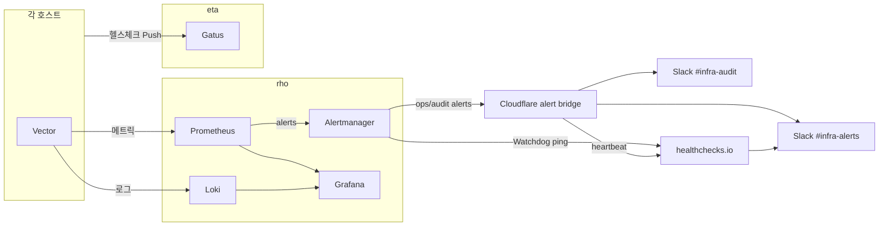

# 모니터링

## 운영 모드

공통 설정은 현재 `observe`입니다. 수집·대시보드·Prometheus 규칙 평가는 유지하지만 Alertmanager의 외부 전송은 discard 처리합니다. `paused`는 수집·평가를 중단하며, `active` 전환과 실제 알림·복구 전송 테스트는 별도 승인 대상입니다.

`active`에서는 즉시 대응과 업무시간 대응을 구분합니다. 업무시간은 평일 09:00–18:00 Asia/Seoul이며 공휴일 예외나 요약 발송은 없습니다. 아래 알림 연결도는 활성 모드의 경로이며 현재 외부 알림 전송을 뜻하지 않습니다.

### 보수 중 자동 업데이트 차단

자동 업데이트 차단 여부는 각 호스트에서 `systemctl cat auto-upgrade.service auto-upgrade.timer auto-reboot.service auto-reboot.timer`로 확인합니다. 런타임 drop-in의 존재를 Git 선언만으로 추정하지 않습니다.

`/etc/systemd/system.control/{auto-upgrade,auto-reboot}.{service,timer}.d/90-migration-pause.conf`가 있으면 재부팅과 일반 Nix 배포 후에도 차단될 수 있습니다. `/run/systemd/system/`의 동일 이름 drop-in도 확인합니다. `/run/infra-maintenance-resume-automatic-updates` marker 생성으로 실행 조건을 우회하지 않습니다.

차단 해제는 변경 검토·배포·운영 검증을 마친 뒤 별도 승인으로 수행합니다. 해당 drop-in을 제거하고 daemon reload·timer 재활성화 후 다음 실행 시각과 실제 적용 상태를 확인합니다.

## 대시보드

- **Grafana**: `https://logging.sjanglab.org` (Authentik Forward Auth, localhost upstream, 신규 인증 사용자 Viewer)
  - `SjangLab Infrastructure` (홈): 현재 건강 상태와 감사 요약 카운트
  - `SjangLab Hosts`: 호스트 리소스, 메트릭 freshness, Headscale 노드 상태
  - `SjangLab Apps`: Gatus 앱 smoke 상태와 앱 인증/거부 흐름
  - `SjangLab Jobs`: db-sync 및 batch/sync/backup 상태
  - `SjangLab Access & Audit`: SSH bastion, Authentik, Headscale 감사 드릴다운
  - `SjangLab AI Resources`: AI 서비스 smoke, psi 리소스, 데이터 동기화 상태
  - `SjangLab PostgreSQL`: rho primary, tau replica, streaming lag, slot WAL 여유, replication 감사 이력
- **Gatus**: `https://status.sjanglab.org` (tailnet 내부 공개 상태 페이지)
  - PostgreSQL은 `primary rho`와 `replica tau`를 별도 endpoint로 표시합니다.

## 스택 구성



### Vector (로그/메트릭 수집)

모든 호스트에서 실행됩니다:

| 수집 대상 | 전송처 | 주기 |
|---------|--------|------|
| sshd 로그 | Loki (rho:3100) | 실시간 |
| SSH bastion forward 매핑 | Loki (rho:3100) | 실시간 |
| auditd 로그 | Loki (rho:3100) | 실시간 |
| Authentik 감사 이벤트 (eta) | Loki (rho:3100) | 실시간 |
| Headscale 컨트롤플레인 이벤트 (eta) | Loki (rho:3100) | 실시간 |
| Headscale 노드 인벤토리 스냅샷 (eta) | Loki (rho:3100) | 300초 |
| 호스트 메트릭 | Prometheus (rho:9090) | 60초 |
| Borg·PostgreSQL 작업 완료 결과 | Prometheus (rho:9090) | 60초 |
| RAID·SMART exporter metrics (psi/rho/tau) | Prometheus (rho:9090) | 60초 |
| PostgreSQL exporter metrics (rho/tau) | Prometheus (rho:9090) | 30초 |
| PostgreSQL replication audit snapshot (rho/tau) | Loki (rho:3100) | 60초 |

eta는 SSH 인증 로그와 같은 PID의 outbound socket을 관찰해 `ssh_bastion` 로그를 생성하고 Loki로 직접 전송합니다. ProxyJump 때문에 대상 호스트가 eta의 내부 IP만 보더라도 실제 접속원 IP, bastion 사용자, 대상 호스트를 함께 조회할 수 있습니다.

```logql
{log_type="ssh_bastion", event="bastion_forward"}
```

대상 호스트의 SSH 로그와 맞출 때는 `target_host`, `bastion_user`, 시간대, `bastion_local_port`를 함께 봅니다. 대상 호스트 sshd 로그의 `source_port`가 eta에서 기록한 `bastion_local_port`입니다.

### 백업 완료 결과

psi·rho·tau의 Borg·PostgreSQL 덤프는 종료 시각과 정상 완료 여부만 기록합니다. Vector가 `infra_job_last_completion_timestamp_seconds`와 `infra_job_last_result`를 전송하며, 최초 완료 전에는 값을 생성하지 않습니다. 결과 0은 정상 완료, 1은 비정상 완료입니다. 실행 중 상태나 별도로 보존된 마지막 성공 이력으로 해석하지 않습니다.

Jobs 대시보드는 마지막 완료 결과와 경과 시간을 표시합니다. 예약 백업·주간 Borg 무결성 검사의 실패, 선행 덤프 실패, 백업 36시간·검사 9일 완료 지연, 완료 관측 누락을 구분합니다. 주간 검사는 파일 추출이나 DB 복원을 하지 않습니다. 누락은 실패나 복구의 증거가 아닙니다. 일정·범위·복원 절차는 [백업 문서](backup.md)를 봅니다.

Docling은 구성에서 비활성화되어 있습니다. 활성화하려면 host import, Gatus 등록, probe target, 인증서 동기화 선언을 함께 검토하고 승인 후 적용합니다. 감시 대상에서 빠진 상태를 서비스 정상 동작으로 해석하지 않습니다.

### 접근 감사 (Authentik / Headscale)

eta의 Vector가 journald에서 수집해 이벤트를 분류합니다 (`modules/authentik/audit.nix`, `modules/headscale/audit.nix`):

- **Authentik** (`log_type="authentik"`): `login`, `login_failed`, `logout`, `app_authorize`(브라우저 앱 인가), `admin_change`, `policy_error`, `forward_auth_deny`
- **Headscale** (`log_type="headscale"`): `node_register`, `node_expire`, `preauth_key`, `oidc_denied`, `error` — 컨트롤플레인/멤버십 감사이며 tailnet 데이터플레인 트래픽은 관측 대상이 아닙니다
- **Headscale 노드 인벤토리** (`log_type="headscale_nodes"`): 5분 주기 스냅샷 (`event="node_snapshot"`)과 집계 행(`event="nodes_summary"`)으로 node, user, IP, tags, online, health, health_reason, last_seen_seconds, expiry_seconds를 기록합니다

```logql
{log_type="authentik", event="login_failed"}
{log_type="headscale", event="node_register"}
```

**레이블 정책**: Loki 레이블은 bounded 값(`host`, `log_type`, `event`)만 사용합니다. `user`, `source_ip`, `app`, `node` 등 고카디널리티 값은 JSON 필드로만 저장하고 LogQL `| json`으로 조회합니다. 시크릿/쿠키/인증 헤더는 수집하지 않습니다. Authentik `login`/`app_authorize` 이벤트의 `client_ip`는 실제 클라이언트 IP로 보존하지만, `forward_auth_deny`의 `remote`는 내부 프록시 주소일 수 있어 `proxy_remote` 필드로만 기록합니다.

### Prometheus (rho)

- 리텐션: 30일
- Remote write receiver 활성화
- Scrape jobs:
  - `vector`: rho Vector exporter
  - `blackbox_exporter`: eta blackbox exporter 자체 health
  - `alertmanager`: rho Alertmanager health (Alertmanager SOPS keys가 있을 때)
  - `blackbox_http`: eta vantage public HTTPS probes (`auth`, `hs`, `n8n`)
  - `blackbox_tailnet_http`: eta vantage wg-admin HTTPS probes with Host/SNI override for tailnet-only apps (`n8n-ui`, `grafana`, `nextcloud`, etc.)
  - `blackbox_tcp`: eta vantage TCP probe for Upterm
  - `blackbox_icmp`: eta vantage ICMP probe for wg-admin host reachability
  - `nvidia-gpu`: psi GPU exporter
  - `postgresql`: rho/tau local postgres_exporter metrics relayed through Vector
- Alert rules: 호스트 관측 누락, 공간 부족, PostgreSQL 상태·replication, 등록 서비스 probe 실패·관측 누락, TLS 만료, Vector 전송 오류, 규칙 평가 실패, 예약 작업·백업 덤프 실패·완료 지연·관측 누락, RAID·SMART 상태와 수집 누락, Watchdog
- Alert delivery: 현재 `observe`에서는 외부 전송하지 않습니다. `active`에서 정책상 대응이 필요한 operational alert를 Cloudflare Worker/D1 bridge로 전송합니다. 서비스별 소유 호스트·접근 경로·대응 정책은 `modules/monitoring/targets.nix`에 선언하며, 의존 대상 장애는 종속 경보를 억제합니다.
- Alert bridge: Bridge는 자체 healthchecks.io heartbeat를 사용합니다. healthchecks.io 알림은 별도 cutover 전까지 기존 Slack integration을 유지합니다.

### Alert response runbook

공통 절차:

1. Slack alert의 `host`, `service`, `alert_category`, `dashboard_url`, `runbook_url`를 확인합니다.
1. Grafana dashboard에서 같은 시간대의 metrics/logs를 확인합니다.
1. 서비스 단위 장애면 `systemctl status <unit>`와 `journalctl -u <unit> -e`를 먼저 확인합니다.
1. 사용자 영향이 있으면 `#infra-alerts`에 조사 시작/완료 시간을 남깁니다.
1. 원인을 모르면 silence하지 않습니다. 노이즈성 반복일 때만 만료 시간이 있는 silence를 설정합니다.

alert별 1차 확인:

| Alert | 1차 확인 | 다음 조치 |
|-------|----------|----------|
| `HostMetricsMissing` | `systemctl status vector`, 네트워크, rho Prometheus target | Vector 재시작 또는 wg-admin 연결 복구 |
| `DiskSpaceLow` / `DiskSpaceCritical` | `df -h`, `du -xhd1 <mount>` | GC, 오래된 workspace 정리, root filesystem 증설 |
| RAID·SMART 하드웨어 경보 | `/proc/mdstat`, `smartctl`, 대상 by-id 디스크 | 실제 장애 여부 확인 후 디스크 교체·배열 복구 계획 |
| RAID·SMART 수집 누락 경보 | node/smartctl exporter, Vector와 원격 전송 | 수집 경로 복구. 관측 누락만으로 디스크 고장 판정 금지 |
| `BlackboxExporterDown` | eta의 `prometheus-blackbox-exporter.service` | exporter 재시작, listen address와 방화벽 확인 |
| `ServiceUnavailable` / `ServiceObservationMissing` | 대상 probe, 접근 경로, DNS, nginx 인증서 | 실제 접근 실패와 관측 누락을 구분해 조사 |
| `TlsCertificateExpiringSoon` | eta ACME timer와 대상 `acme-sync-*` unit | 인증서 갱신 후 대상 호스트 동기화 확인 |
| `AcmeRenewalFailed` | eta의 `acme-order-renew-*` journal과 `log_type="systemd_status"`, `job_class="acme"` | HTTP-01은 공개 DNS·80번 포트·nginx challenge 경로, DNS-01은 resolver·TXT 전파·토큰 권한 확인. 원인 해결 후 재검증·필요 시 unpause |
| `NvidiaGpuExporterDown` | psi exporter service와 `nvidia-smi` | NVIDIA driver/GPU 상태 확인 후 exporter 복구 |
| `PostgresqlDown` / `PostgresqlExporterMissing` | rho/tau `postgresql.service`, `prometheus-postgres-exporter.service`, Vector | DB 또는 exporter 복구 후 `pg_up` 확인 |
| `PostgresqlReplicaNotStreaming` / `PostgresqlReplicationLagHigh` | rho `pg_stat_replication`, tau `pg_stat_wal_receiver` | 연결·WAL 상태 확인, WAL 유실이면 tau 재-bootstrap |
| `PostgresqlReplicationSlotInactive` / `PostgresqlReplicationSlotWalRisk` | rho `pg_replication_slots` | tau 상태 복구. `wal_status=lost`면 새 basebackup 수행 |
| `PostgresqlAuditSnapshotsMissing` | rho/tau audit timer와 Vector/Loki | timer·전송 경로 복구 후 누락 구간 기록 |
| `ScheduledJobFailed` / `BackupDumpFailed` | 백업·덤프 journal, 종료 결과 | 원인 수정 후 systemd 백업 서비스로 재실행 |
| `BackupCompletionOverdue` | 05:30 타이머, 덤프 의존성, Borg 실행 여부 | 36시간 완료 지연 원인 조사 |
| `BackupVerificationOverdue` | 일요일 09:00 타이머, Borg 검사 journal | 9일 완료 지연 원인 조사 |
| `BackupObservationMissing` | 최초 실행 여부, 완료 기록 파일, Vector job source·sink | 초기 검사 또는 관측 경로 복구. 실패·성공 추정 금지 |
| `AuditJobFailed` / `AuditJobStale` | `log_type="systemd_status"`, 대상 audit timer/service | 감사 수집 unit 복구 후 누락 구간 확인 |
| `AuditCorrelatorHeartbeatMissing` | rho audit correlator service와 Loki 수신 | correlator·Loki 연결 복구 후 heartbeat 확인 |
| `NginxAccessLogsMissing` | nginx access log, Vector source, Loki | 로그 파일 권한과 Vector pipeline 복구 |
| `HeadscaleNodeSnapshotsMissing` | eta snapshot timer/service와 Loki | snapshot job 복구 후 새 `node_snapshot` 확인 |
| `SshLoginFailureBurst` | `log_type="ssh"`, source IP, 대상 user | 오탐 확인 후 계정/키 검토와 IP 차단 |
| `AuthentikLoginFailureBurst` / `AuthentikForwardAuthDenyBurst` | Authentik audit log의 user, app, source IP | 사용자 영향과 계정 탈취 여부 확인 |
| `HeadscaleOidcDenied` / `HeadscaleNodeExpired` | Authentik group, `users.yaml`, node expiry | 정당한 사용자면 inventory/expiry 수정 후 Terraform apply |
| `Watchdog` 미수신 | Alertmanager, healthchecks.io ping URL, 네트워크 | Alertmanager 복구. bridge 장애와 분리 확인 |

`AcmeRenewalFailed`는 기존 systemd 상태 snapshot으로 auto-restart 중인 실패도 감지합니다. 10분 이내 실패가 있고 최근 2분 내 정상 snapshot이 없으면 5분 후 경보를 발생시킵니다. 정상 snapshot 수신 후 이전 실패로 인한 경보는 해제됩니다. snapshot 전송 자체가 끊기면 이 규칙은 실패를 판정하지 못하므로 Vector와 호스트 수집 상태도 함께 확인합니다.

감사 alert는 `#infra-audit`에 도착합니다. 사용자명, source IP, app/node 정보를 기록하고 계정 탈취 가능성이 있으면 Authentik 계정 비활성화와 Headscale ACL apply를 우선합니다.

### PostgreSQL replica recovery

일시적인 네트워크 장애는 slot이 보존한 WAL로 자동 복구됩니다. `requested WAL segment ... has already been removed` 또는 `wal_status=lost`이면 기존 PGDATA를 다시 시작하지 않습니다.

1. tau의 `postgresql.target`을 중지합니다.
1. `/var/lib/postgresql/17`을 timestamp가 붙은 `17.stale-*` 경로로 이동해 보존합니다.
1. rho의 inactive/lost `tau` slot을 삭제하고 physical slot을 다시 만듭니다.
1. `inv deploy --hosts tau`를 실행하면 `postgresql-replica-init`이 `pg_basebackup --slot=tau`로 새 replica를 구성합니다.
1. rho `pg_stat_replication`의 `application_name=tau`, `state=streaming`과 tau `pg_is_in_recovery()=true`를 확인합니다.
1. Grafana와 Loki에서 byte lag 0, healthy audit snapshot, `replica_basebackup_completed`를 확인합니다.

stale PGDATA는 새 replica와 backup 검증 완료 전 삭제하지 않습니다.

### Alert delivery bootstrap

Slack 앱 설정은 `slack/infra-alerts/slack-app-manifest.json`이 source of truth입니다. `slack/infra-alerts` 디렉터리에서 direnv를 허용하면 Slack CLI가 포함된 `slack-deploy` shell에 들어갑니다:

```bash
cd slack/infra-alerts
direnv allow
```

운영 원칙:

- Slack app/bot/scope: manifest JSON으로 선언하고 Slack CLI가 `.slack/hooks.json`을 통해 app을 생성/업데이트합니다.
- Slack app install: Slack CLI로 app을 install하고, 필요하면 admin OAuth 승인을 완료합니다.
- Slack channel: workspace resource라 수동으로 준비합니다 (`#infra-alerts`, `#infra-audit`).
- Slack bot token: external alert bridge가 `chat:write`로 메시지를 생성/수정할 때 사용합니다. CI에 넣지 않습니다.
- Slack webhook URL: bridge migration 동안만 유지되는 channel-bound secret입니다.
- healthchecks.io checks: `terraform/healthchecksio`에서 `rho-alertmanager-watchdog`와 `infra-alert-bridge-heartbeat`를 관리하고, sensitive `ping_url` output을 SOPS에 수동 저장합니다. healthchecks.io Slack integration은 bridge migration 동안 유지합니다.
- Alert bridge: `terraform/alert-bridge`가 Cloudflare Worker/D1/secret binding/cron을 관리합니다. D1 migration은 Worker 배포 후 수동으로 실행합니다.
- CI: manifest JSON syntax 검증만 합니다. Slack token이나 webhook URL을 CI에 넣지 않습니다.

필요한 SOPS keys:

```yaml
alertmanager-bridge-token: ENC[...]
alertmanager-healthchecks-ping-url: ENC[...]
```

Rollback window 동안만 legacy Slack incoming webhook secrets를 유지합니다:

```yaml
alertmanager-slack-infra-alerts-webhook: ENC[...]
alertmanager-slack-infra-audit-webhook: ENC[...]
```

자세한 Slack bootstrap/drift check 절차는 `slack/infra-alerts/README.md`를 봅니다.

### Alert bridge cutover

`active` 모드에서 사용할 Alertmanager 전송 경로는 Cloudflare Worker bridge입니다. 현재 `observe`의 discard 라우팅을 확인한 상태에서 아래 cutover는 별도 승인 후 수행합니다.

1. `terraform/alert-bridge` apply 완료 확인
1. `packages/infra-alert-bridge`에서 D1 migration 실행
1. Worker `GET /healthz`와 cron heartbeat 확인
1. Alertmanager receiver가 bridge `POST /alertmanager`와 bearer token을 사용하는지 확인
1. `#infra-alerts`, `#infra-audit`에 firing/resolved/update 메시지가 같은 thread로 정상 생성되는지 확인
1. rollback window 동안 legacy Slack webhook secret 유지
1. 안정화 후 `incoming-webhook` Slack scope와 webhook SOPS key 제거

healthchecks.io webhook integration은 아직 legacy Slack integration을 유지합니다. 이후 bridge `POST /healthchecks`와 bearer token으로 전환합니다. Worker 장애가 Watchdog ping 자체를 막지 않도록 `rho-alertmanager-watchdog`은 healthchecks.io로 직접 ping합니다.

### Loki (rho)

- 리텐션: 기본 7일, 감사 스트림(`log_type=~"ssh|ssh_bastion|access_audit|audit|authentik|headscale|postgresql_audit"`)은 90일
  - `headscale_nodes` 스냅샷은 반복 상태 데이터라 기본 7일 적용
- 스토리지: 로컬 파일시스템 (`/var/lib/loki`)

### Gatus (eta)

- Pull 방식: eta에서 직접 접근 가능한 서비스 (Authentik, Headscale, Upterm 등)
- Push 방식: 내부 서비스가 로컬/사용자 경로를 확인한 뒤 상태 보고
- 저장소: SQLite (`/var/lib/gatus/gatus.sqlite`)로 재시작 후 uptime 유지
- External endpoint heartbeat: 15분 동안 push가 없으면 실패 처리
- 그룹: `apps`, `ai`, `ci`, `monitoring`, `platform`, `storage`
- 기본 정렬: group 기준
- 알림: Gatus 직접 전송 없음. `observe`에서는 외부 알림을 보내지 않습니다. 서비스 경보는 등록된 probe와 대응 정책을 기준으로 평가합니다.
