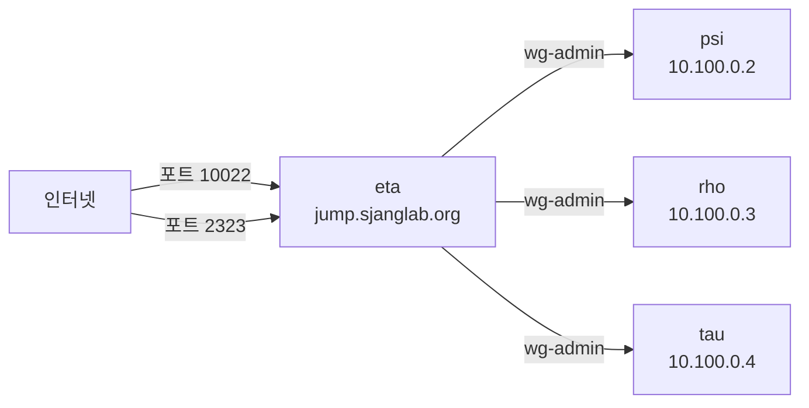
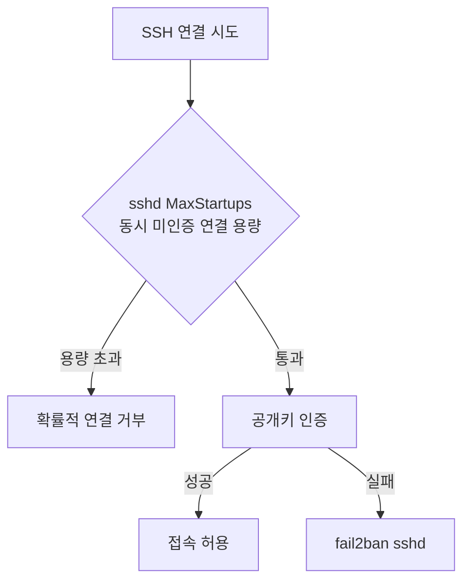
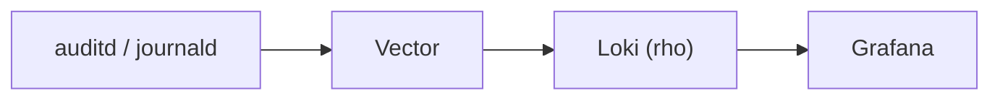

# 보안

인프라 전반의 보안 정책과 구현 현황을 정리합니다.

## 네트워크 보안

### 방화벽 정책

인터페이스별 화이트리스트 방식으로 포트를 관리합니다.

| 인터페이스 | 용도 | 열린 포트 |
|-----------|------|----------|
| eta eth0 (퍼블릭) | public edge | TCP 80, 443, 10022, 2323; UDP 51820 |
| psi eth0 (퍼블릭) | WireGuard/Tailscale transport | UDP 51820, 41641; public TCP 없음 |
| rho/tau eth0 (랩 내부 NAT) | LAN 및 VPN transport | tau TCP 80, 443; UDP 51820, 41641 |
| wg-admin (WireGuard) | 신뢰된 호스트 간 관리·서비스 트래픽 | 모든 포트 |
| tailscale0 (Headscale) | 사용자 서비스 | 서비스별 (주로 80, 443) |

기본 정책은 **deny all**입니다. 단, `wg-admin`은 `networking.firewall.trustedInterfaces`에 등록되어 호스트 방화벽이 모든 트래픽을 허용합니다. wg-admin 서비스는 listen address와 WireGuard peer 관리로 노출 범위를 제한합니다. 퍼블릭·Headscale 인터페이스는 각 서비스 모듈이 필요한 포트만 개방합니다.

### Bastion 아키텍처

eta가 유일한 인터넷 노출 SSH 호스트입니다. Upterm relay도 eta의 `2323/tcp`에서만 외부에 노출됩니다. 다른 호스트(psi, rho, tau)는 `wg-admin` 인터페이스에서만 SSH를 수신합니다.



### SSH 연결 보호

eta는 공개키 인증만 허용합니다. 순차 연결 횟수 기반 방화벽 제한은 정상적인 관리자 접속과 병렬 배포를 차단하므로 사용하지 않습니다.



| 계층 | 설정 | 목적 |
|------|------|------|
| OpenSSH | `MaxStartups 64:30:256` | 병렬 배포를 수용하면서 동시 미인증 연결 폭주 제한 |
| fail2ban `sshd` | 10분 내 인증 실패 3회, 기본 5분 차단 | 반복 인증 공격 차단 |

재차 차단되는 IP는 전체 jail 이력을 기준으로 차단 시간이 지수 증가하며 최대 7일까지 늘어납니다. 단순 TCP 연결 종료를 공격으로 간주하는 aggressive jail은 사용하지 않습니다.

### WireGuard VPN 분리

| 네트워크 | 대역 | 용도 |
|---------|------|------|
| wg-admin | `10.100.0.0/24` | 인프라 관리 (SSH, DB, 내부 서비스) |
| Headscale | `100.64.0.0/10` | 사용자 서비스 접근 (웹 서비스) |

두 네트워크는 독립적입니다. wg-admin peer key는 인프라 호스트와 승인된 관리자 기기에만 배포합니다. 일반 사용자는 wg-admin peer가 되지 않으며, SSH가 허용된 사용자는 eta bastion을 통해 대상 호스트의 wg-admin 주소로 접속합니다.

## 계정 및 권한 정책

### 사용자 계층

| 역할 | NixOS 그룹 | sudo | Docker | SSH 호스트 | 만료 |
|------|-----------|------|--------|-----------|------|
| 관리자 | `wheel`, `docker`, `admin`, `input` | O | O | 전체 | — |
| 연구원 | `docker`, `researcher`, `input` | X | O | 지정 호스트 | 필수 |
| 학생 | `docker`, `student`, `input` | X | O | 지정 호스트 | 필수 |

### Root 접근 정책

| 접근 경로 | 허용 |
|----------|------|
| SSH (인터넷) | **차단** (`PermitRootLogin no`) |
| SSH (wg-admin, 10.100.0.0/24) | 공개키만 (`prohibit-password`) |
| sudo (로컬) | `wheel` 그룹만 |

root의 `authorized_keys`에는 관리자 키만 등록됩니다 (`modules/users/admins.nix`).

### 시스템 계정

서비스별로 전용 시스템 계정이 분리되어 있습니다.

| 계정 | 서비스 | 유형 | 특기 사항 |
|------|--------|------|----------|
| `nixbot` | Nixbot CI | isSystemUser | psi의 `nix.settings.extra-allowed-users`에 명시 |
| `niks3` | Nix 캐시 control plane | system user | R2 credential과 signing key만 읽기 가능 |
| `root` (백업 unit) | 로컬 Borg·eta Restic | privileged systemd job | 시스템 파일·SQL 덤프 접근; 저장소 키와 환경 파일은 root 전용 |
| `acme-sync-*` | TLS 인증서 동기화 | — | rsync 전용, 제한된 경로 |
| `postgres` | PostgreSQL | isSystemUser | DB 전용 |
| `nextcloud` | Nextcloud | isSystemUser | — |

### Nix 권한

| 설정 | 대상 | 의미 |
|------|------|------|
| `allowed-users` | 모든 로컬 계정 (`*`) | Nix daemon 연결, store 조회, 일반 build 허용 |
| `extra-allowed-users` | psi의 `nixbot` | Nixbot service account를 명시적으로 허용하며 현재 wildcard와 중복 |
| `trusted-users` | `root` (NixOS), `@wheel` (srvos), `seungwon` (admin module) | 임의 substituter와 서명되지 않은 store path 등 privileged daemon 기능 허용 |

일반 연구원·학생 계정은 `nix shell`, `nix run`, `nix develop`을 사용할 수 있지만 trusted user 권한은 없습니다. `allowed-users`는 SSH 로그인이나 호스트 접근 권한을 부여하지 않습니다.

## SSH 보안

### 알고리즘 정책

| 항목 | 허용 알고리즘 |
|------|-------------|
| Ciphers | `chacha20-poly1305`, `aes256-gcm`, `aes128-gcm` |
| KexAlgorithms | `curve25519-sha256`, `diffie-hellman-group16-sha512`, `diffie-hellman-group18-sha512` |
| MACs | `hmac-sha2-512-etm`, `hmac-sha2-256-etm` |

### 세션 정책

| 설정 | 값 |
|------|-----|
| 인증 방식 | 공개키만 (비밀번호 비활성화) |
| 키 알고리즘 | Ed25519 권장 |
| MaxAuthTries | 3 |
| LoginGraceTime | 30초 |
| ClientAliveInterval | 1200초 (20분) |
| X11Forwarding | 비활성화 |
| Compression | 비활성화 |

### SSH CA 인증서

호스트 키는 CA로 서명되어 있어 `known_hosts`에 CA 공개키만 등록하면 모든 호스트를 신뢰할 수 있습니다.

```
@cert-authority *.sjanglab.org ssh-ed25519 AAAAC3...
```

설정 위치: `modules/sshd/certs/`

## 비밀 관리

### sops-nix + age

모든 비밀은 age(Curve25519) 암호화로 보호됩니다. 호스트별 age 키와 관리자 키가 각 비밀 파일을 복호화할 수 있습니다.

| 비밀 파일 | 접근 가능 키 | 내용 |
|----------|------------|------|
| `hosts/<host>.yaml` | 해당 호스트 + admin | root 비밀번호 해시, WireGuard 키, 호스트별 백업 암호·DB credential |
| `hosts/eta.yaml` | eta + admin | eta Restic repository password와 전용 R2 토큰 |
| `hosts/psi.yaml`, `hosts/rho.yaml`, `hosts/tau.yaml` | 해당 호스트 + admin | Borg passphrase·암호화된 recovery key; recovery key는 runtime secret으로 배포하지 않음 |
| `modules/acme/secrets.yaml` | eta·psi·tau + admin (recipient 정책) | 비공개 인증서용 Cloudflare API 인증, 인증서 동기화 SSH 키 |
| `modules/buildbot/secrets.yaml` | psi + admin | Nixbot GitHub App/OAuth 시크릿 |
| `modules/gitea-mq/secrets.yaml` | eta + admin | merge queue GitHub App private key와 webhook secret |
| `modules/authentik/secrets.yaml` | eta + admin | OIDC 클라이언트 시크릿 |

### 비밀 편집

```bash
# Edit in a protected local editor
sops hosts/psi.yaml

# Regenerate policy and recipients after approved key changes
inv update-sops-files
```

접근 권한은 표의 요약보다 `.sops.nix`·생성된 `.sops.yaml`을 우선합니다. 값 자체는 출력하지 않으며 자세한 편집·전달·회전 절차는 [비밀 관리](secrets-management.md)를 참조합니다.

## TLS 인증서 { #tls-certificates }

인증서는 eta에서 Let's Encrypt ACME로 발급합니다. 공개 nginx vhost는 HTTP-01을 사용하고, 공개 HTTP endpoint가 없는 비공개 서비스의 certificate-only 항목은 Cloudflare DNS-01을 사용합니다. 다른 호스트에서 사용하는 인증서는 `acme-sync` 서비스가 rsync로 동기화하고, 대상 호스트의 systemd path unit이 파일 변경을 감지하여 nginx를 자동 리로드합니다. Nixbot도 eta 인증서를 psi에 동기화하며, psi에서는 별도 발급이나 Cloudflare 토큰을 사용하지 않습니다.

| 도메인 | 발급 호스트 | 사용 호스트 |
|--------|-----------|-----------|
| `auth.sjanglab.org` | eta | eta |
| `vault.sjanglab.org` | eta | eta |
| `hs.sjanglab.org` | eta | eta |
| `cloud.sjanglab.org` | eta | tau (동기화) |
| `n8n.sjanglab.org` | eta | tau (동기화) |
| `logging.sjanglab.org` | eta | eta (public edge), rho (동기화, 인증·Grafana) |
| `status.sjanglab.org` | eta | rho (동기화) |
| `nixbot.sjanglab.org` | eta | eta (public edge), psi (동기화, service stack) |
| `mq.sjanglab.org` | eta | eta |
| `upterm.sjanglab.org` | eta | eta |

인증서 동기화: eta에서 발급 → `acme-sync` 서비스가 rsync로 대상 호스트에 전송 → systemd path unit이 변경 감지 → nginx 자동 리로드. Nixbot 수신 계정은 psi의 `acme-sync-nixbot`입니다. Docling의 서비스·인증서·동기화 선언은 비활성 상태이며 현재 제공 경로에 포함하지 않습니다.

### ACME 갱신 실패 대응

공개 vhost는 nginx의 `enableACME = true`로 HTTP-01을 처리합니다. 기존 공개 DNS와 80번 포트를 사용하며, 애플리케이션의 인증·경로 제한은 그대로 유지합니다. 비공개 certificate-only 항목은 DNS-01 전파 확인에만 `8.8.8.8:53`을 사용합니다. 시스템 resolver와 Headscale split DNS는 변경하지 않으며, 전파 확인과 대기 시간은 lego 기본 정책을 유지합니다.

`modules/acme/secrets.yaml`의 `cloudflare-credentials`는 ACME 전용입니다. `CLOUDFLARE_DNS_API_TOKEN`과 `CLOUDFLARE_ZONE_API_TOKEN`에 같은 토큰을 사용하며, 필요한 권한은 `sjanglab.org`의 DNS Edit와 Zone Read입니다. Terraform DNS, Worker/D1, R2 자격증명과 별도로 관리합니다.

`AcmeRenewalFailed`가 발생하면 eta의 `acme-order-renew-<domain>.service` journal을 확인합니다. HTTP-01은 공개 DNS·80번 포트·nginx challenge 경로를, DNS-01은 토큰 권한·TXT 전파·resolver 접근성을 확인합니다. 원인을 해결하고 한 인증서로 검증한 뒤 나머지를 갱신합니다. Let's Encrypt의 연속 인증 실패 정지가 남아 있으면 journal의 공식 해제 링크로 unpause합니다. 이 링크는 해제용 토큰을 포함하므로 채팅·공개 이슈·문서에 공유하지 않습니다.

Nixbot 동기화 전환 시에는 기존 인증서가 있는 psi에 수신 계정과 watcher를 먼저 적용한 뒤 eta에 발급·송신 설정을 적용합니다. 새 psi를 처음 구성할 때는 nginx를 시작하기 전에 인증서 디렉터리에 유효한 인증서를 먼저 동기화해야 합니다. 전환 후 `acme-sync-nixbot-to-psi.service`를 실행하고 양쪽 인증서와 nginx reload를 확인합니다. 나머지 인증서도 만료일, `acme-sync-*` 동기화, 실제 HTTPS endpoint의 인증서를 확인합니다. 경보 규칙 변경은 rho에도 적용해야 합니다. 반복 실패를 무시하거나 DNS 전파 확인을 끄는 방식으로 우회하지 않습니다.

## 데이터 보안

### PostgreSQL

| 설정 | 값 |
|------|-----|
| 바인드 주소 | rho primary는 wg-admin IP, tau replica는 localhost; 호스트별 서비스 모듈로 제한 |
| 인증 방식 | SCRAM-SHA-256 (원격), Peer (로컬) |
| 복제 | WAL 스트리밍 (rho → tau) |
| 암호 관리 | sops 암호화 |

### 백업 저장소의 보안 경계

| 구성 | 범위와 제약 |
|------|-------------|
| psi·rho·tau Borg | 시스템 SSD·SQL 덤프를 같은 호스트의 HDD RAID1에 암호화 저장. 홈·workspace·HDD data·live PGDATA 제외 |
| Borg 키 | 호스트별 SOPS passphrase, repokey-blake2. Git과 별도 위치의 키·identity·저장소 사본이 있어야 호스트 전체 장애에 대비 가능 |
| eta Restic | 전용 비공개 R2 `eta-restic-backups`, PostgreSQL·Vaultwarden별 prefix와 repository password |
| eta R2 토큰 | 해당 버킷만 Object Read & Write. root0400 환경 파일로 전달하며 backup/check/prune가 공유하므로 append-only·역할별 격리 없음 |
| Stalwart blob | runtime은 primary 버킷 전용 토큰, 복사는 source/destination 전용 토큰. DB 메타데이터와 blob의 복구 시점·범위를 함께 확인 |

RAID1과 PostgreSQL replica는 삭제·오염·관리자 실수로부터 독립적인 백업이 아닙니다. 복사 토큰이 source에도 쓰기를 허용하면 source 변경 권한이 없는 것으로 오인하지 않습니다. 과거 저장소와 키의 삭제는 보존·복구 검토 후 별도 승인받습니다. 범위와 검증 절차는 [백업](backup.md)을 따릅니다.

## 감사 및 모니터링

### auditd

Linux 감사 데몬으로 다음을 추적합니다:

| 추적 대상 | 파일 |
|----------|------|
| PAM 세션 | `/var/log/wtmp`, `/var/log/btmp`, `/var/run/utmp` |
| SSH 설정 변경 | `/etc/ssh/sshd_config` |

로그: `/var/log/audit/audit.log` (최대 8MB × 2)

### 로그 파이프라인



## 시스템 안정성

### 자동 업그레이드

| 설정 | 값 |
|------|-----|
| 소스 | `github:SBEE-lab/infra` |
| 업그레이드 | `system.autoUpgrade`가 매일 04:40 KST에 최신 설정 적용 |
| 재부팅 체크 | 매월 마지막 토요일 (`auto-reboot` 서비스) |
| 재부팅 조건 | 커널 변경 시에만 24시간 후 자동 재부팅 |
| 재부팅 지터 | 최대 20분 지연 (호스트별 분산) |

자동 실행은 보수용 drop-in·실행 조건으로 차단될 수 있습니다. 타이머 존재만으로 실행을 보장하지 않으며 실제 차단·해제 절차는 [모니터링 — 자동 업데이트 차단](monitoring.md)을 따릅니다. 승인 없이 marker 생성으로 우회하거나 hold를 제거하지 않습니다.

### 서비스 복구

서비스별 systemd 재시작 정책을 확인합니다. 모든 실패가 자동 복구되는 것은 아닙니다. Gatus(`status.sjanglab.org`)의 헬스체크와 로그·완료 메트릭을 함께 확인합니다. 기본 `observe` 모드는 수집·평가를 유지하지만 Alertmanager 외부 알림은 버립니다. 미수집·무알림을 정상이나 복구로 판정하지 않습니다.
