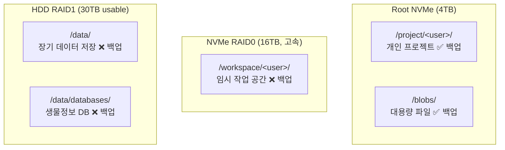

# 연구·개발 환경

SSH 기반 연구 컴퓨팅과 개인 머신의 재현 가능한 개발 환경을 안내합니다.

## 서버 자원

| 호스트 | 역할 | 주요 자원 |
|--------|------|----------|
| **psi** | GPU 연산/CI | RTX A6000 48GB, workspace 16TB NVMe RAID0, data 30TB usable HDD RAID1 |
| **rho** | DB/모니터링 | PostgreSQL primary, Grafana/Prometheus/Loki, 2TB usable HDD RAID1 |
| **tau** | 앱/DB replica | Nextcloud, n8n, PostgreSQL replica, 2TB usable HDD RAID1 |

## 스토리지 구조 (psi 기준)



| 경로 | 용도 | 백업 |
|------|------|------|
| `/project/<username>/` | 개인 프로젝트 (root SSD) | 로컬 Borg, 매일 |
| `/workspace/<username>/` | 임시 작업 공간 (고속 SSD) | X |
| `/data/databases/` | 생물정보 DB (db-sync) | X |
| `/blobs/` | 관리자가 배치하는 대용량/라이선스 파일 | 로컬 Borg, 매일 |
| `/data/` | 장기 데이터 저장 (30TB usable HDD RAID1) | X |

Borg는 매일 05:30 Asia/Seoul에 root filesystem과 `/boot`를 같은 호스트의 `/data/borg/psi`로 백업합니다. `/project`와 `/blobs`는 root filesystem 안에 있을 때 포함되며, 별도 filesystem으로 옮기면 자동으로 포함되지 않습니다. `/home`, `/workspace`, `/data`, live PGDATA는 제외됩니다.

백업은 다른 호스트나 외부 저장소의 사본이 아닙니다. RAID1도 삭제·오염·호스트 전체 장애를 막지 못합니다. 중요한 연구 데이터는 별도 사본을 유지하고 대용량 보호가 필요하면 작업 전에 관리자와 범위를 협의하세요. `/blobs`에는 XFS project quota 200GiB가 적용됩니다. 이 용량 제한은 백업의 성공 여부 판정과 별개입니다.

개인 사용량 확인:

```bash
du -sh /project/$USER
```

백업 완료·실패·관측 누락은 관리자가 Grafana `SjangLab Jobs`와 [백업 가이드](../admin/backup.md) 기준으로 확인합니다. 데이터 복구 요청에는 호스트, 경로, 필요한 시점을 전달하고 키·SQL·연구 원문은 공개 채널에 올리지 않습니다.

## 시작하기

서버 SSH 접속이 필요하면 관리자에게 **사용자명, SSH 공개키, 접근 호스트**를 전달합니다. 상세 절차는 [SSH 접속 — 접근 요청](ssh-access.md#requesting-access)을 참조하세요.

## 가이드 목록

- [SSH 접속](ssh-access.md) — 접근 요청, 서버 연결 및 설정
- [GPU 컴퓨팅](gpu-computing.md) — CUDA, Docker, 컨테이너
- [Apptainer](apptainer.md) — HPC 컨테이너 환경
- [생물정보 DB](bioinformatics-db.md) — BLAST, UniProt, PDB 등
- [Nix 개발 환경](nix-environment.md) — 서버·개인 머신의 패키지와 프로젝트 devShell
- [Home Manager](home-manager.md) — 개인 패키지와 dotfile 관리
- [Upterm](../guide/upterm.md) — 임시 터미널 공유 relay
- [학생 가이드](students/best-practices.md) — 모범 사례, 계정 만료

> **서버 하드웨어/전원/네트워크 문제**: 관리자에게 보고하세요. 물리 서버 관리는 [관리자 가이드 — 데이터센터](../admin/datacenter.md)를 참조하세요.
