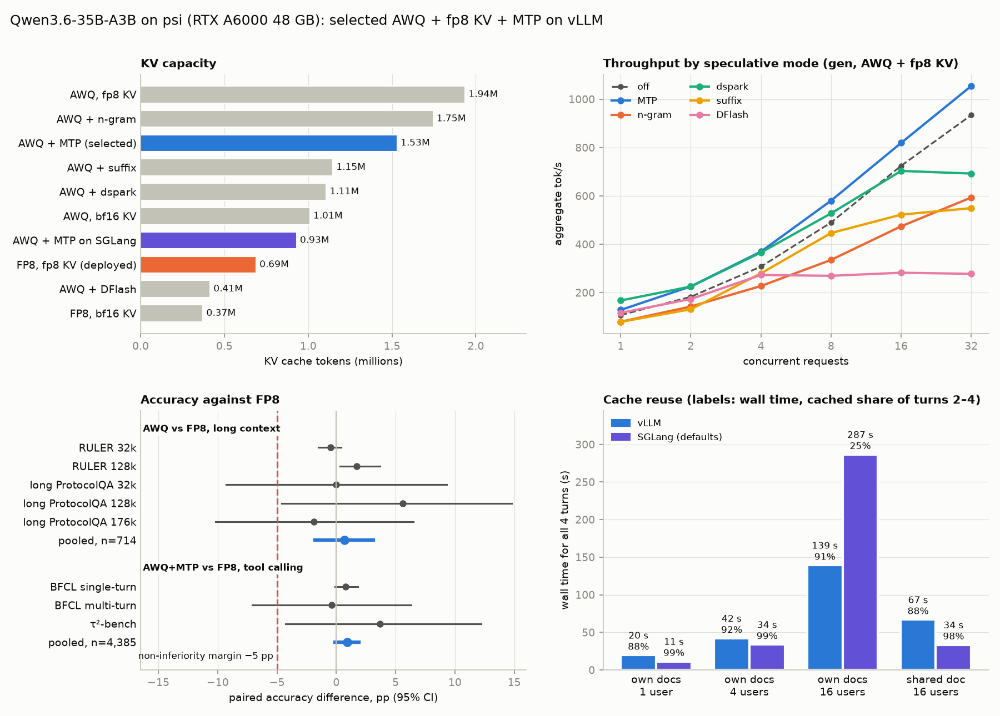

# vLLM on psi

Operational notes for the vLLM module (`default.nix`), which llama-swap starts on demand, and the 2026-10 benchmarks that chose the format and options for serving Qwen3.6-35B-A3B on psi (one RTX A6000 48GB).
The target use is the lab's wet-lab experiment-planning agent (prime-agent, RLM), with about 10 users.

Two selection criteria:

1. Little accuracy loss at long context
2. Plenty of KV cache room, because several users share the server

## Deployment status

**The benchmark decisions are not yet applied to `default.nix`.** The "Deployed" column below is what is serving today.

| Item | Deployed (`default.nix`) | Benchmark decision |
|---|---|---|
| Weights | `Qwen/Qwen3.6-35B-A3B-FP8` | `QuantTrio/Qwen3.6-35B-A3B-AWQ` |
| KV cache | `--kv-cache-dtype fp8` | same |
| Speculative decoding | none | `--speculative-config '{"method":"qwen3_next_mtp","num_speculative_tokens":2}'` |
| KV tokens | 689k | 1.53M |
| Engine | vLLM v0.32.0 | same |

All other flags matched `default.nix` during the benchmarks.

Before switching:

- Download the AWQ weights into `/workspace/shared/huggingface`.
- Add a step cap, a session time cap and repeated-call detection to the agent or gateway (see the repetition notes under [Tool calling](#tool-calling-configstoolsyaml)).
- Check that the production default sampling includes the model card's recommended values.

## Conclusions

| Item | Decision | Evidence |
|---|---|---|
| Weights | **AWQ 4bit** (`QuantTrio/Qwen3.6-35B-A3B-AWQ`) | Long-context accuracy non-inferior to the official FP8 (paired, n=714, +0.7 pp [95% CI −1.8, +3.1]) |
| KV cache | **fp8** | 1.94M KV tokens: 2.8× FP8 weights + fp8 KV (689k), 1.9× AWQ + bf16 KV (1.01M) |
| Speculative decoding | **MTP** (`num_speculative_tokens: 2`) | Best multi-user throughput of the 6 modes (gen concurrency 32 +13%, code generation −30% time). Accuracy unchanged. KV −21% (1.53M) |
| Alternatives (time-sliced) | Night code-edit batches: **suffix** / single-user interactive and code: **dspark** | suffix: edit throughput +161%. dspark: concurrency 1 generation +63%. Both cost KV −41 to −43% and hurt multi-user gen |
| Tool calling | AWQ+MTP ≈ FP8 | BFCL and τ²-bench overall +0.9 pp [−0.1, +1.9]. No parser leaks. The model tends to loop when a tool is missing, so the agent needs a step cap |
| Serving engine | **Keep vLLM** | SGLang is faster with cached 0.99 at concurrency ≤4 and on shared documents, but on different documents at concurrency 16 cached collapses to 0.2–0.3 and wall time doubles. Running cap 15, KV 930k |
| Dropped | n-gram, DFlash | n-gram is weaker than suffix on every metric. DFlash costs KV −79% |

Caveats:

- **MTP gives no benefit when many long inputs are read at once.** At 32k input and concurrency 16, first token arrives +55% later.
- Under that load the bottleneck is input processing (prefill), so the answer is to split chunks to 8k or less and limit concurrent requests per user.

## Environment

| | |
|---|---|
| GPU | NVIDIA RTX A6000 48GB (Ampere, 300 W cap). FP8/INT4 are storage formats only; compute is bf16 |
| Engine | `vllm/vllm-openai:v0.32.0@sha256:befccf0e…` (Docker, `--device nvidia.com/gpu=all`) |
| Production flags | `--max-model-len 262144 --gpu-memory-utilization 0.95 --reasoning-parser qwen3 --tool-call-parser qwen3_coder`, thinking off by default (see `configs/base.yaml`) |
| Evaluation tools | inspect-ai 0.3.286, inspect-evals 0.26.0, lm-eval 0.4.13 (RULER), evalplus 0.3.1 (pinned in `uv.lock`) |
| Model structure | Hybrid attention (10 of 40 layers are full attention), MoE 256 experts / 8 routed, 1 MTP layer |

## Reproduction

The harness lives outside this repository in `~/git/qwen-bench` (a local repository with no remote). The `configs/`, `qb/` and `results/` paths below are all relative to it, and it holds the raw results and per-config plots.

| Config | Contents |
|---|---|
| `configs/formats.yaml` | Round 1.1 |
| `configs/full.yaml` | Round 1.5 |
| `configs/spec.yaml` | Speculative decoding |
| `configs/tools.yaml` | Tool calling |
| `configs/sglang.yaml` | SGLang comparison |

- Run with `qb run CONFIG`, print tables with `qb report CONFIG`, and compare pairs with `qb compare CONFIG BASE OTHER`.
- `benchmark-summary.png` comes from `python -m qb.summary OUT.png`.
- off, MTP, n-gram, the dspark speed and ProtocolQA runs, and the format comparison were measured with shell scripts before the harness cleanup. Their results were moved into the same layout.
- The format comparison was recomputed with `qb compare` and gave the same numbers.

## Benchmarks

### Common rules

- Official evaluation methods (prompts, templates, scorers) are used as is. The only choices of ours are thinking off and a `max_tokens` cap (32k).
  - Exception: round 1 used our own prompts, so it serves only for relative comparison between configs.
- Configs are compared **pairing the same items** (RULER by prompt hash, ProtocolQA by sample id).
- Non-inferiority criterion: lower bound of the 95% bootstrap CI of the paired difference > −5 pp.
- Public benchmarks may have leaked into training data. Look at differences between configs rather than absolute scores.

### Round 1: four formats, short context

Weights {FP8, AWQ} × KV {fp8, bf16}. ProtocolQA 108 items + MMLU-Pro biology 717 items. Thinking off, temperature 0, `max_tokens` 4096, input under 8k.

| | fp8w-fp8kv (deployed) | fp8w-bf16kv | awq-fp8kv | awq-bf16kv |
|---|---|---|---|---|
| ProtocolQA (108) | 61.1% | 58.3% | 60.2% | 58.3% |
| MMLU-Pro bio (717) | 91.8% | 91.2% | 91.5% | 91.5% |
| Paired against deployed (825 items) | – | +17 / −24 | +18 / −21 | +14 / −19 |
| Weights / KV (GiB) | 34.6 / 6.95 | 34.6 / 7.3 | 22.2 / 19.5 | 22.2 / 19.9 |
| KV tokens (number of 262k requests) | 689k (2.6) | 372k (1.4) | **1.94M (7.4)** | 1.01M (3.9) |
| Generation tok/s (short / 80k / 205k) | 127 / 111 / 93 | 127 / 98 / 73 | 110 / 98 / 84 | 109 / 87 / 67 |
| Input processing tok/s (80k / 205k) | 4.8k / 3.6k | 5.1k / 4.1k | 5.2k / 3.7k | 5.6k / 4.2k |
| Concurrency 32 throughput tok/s | 822 | 800 | **1038** | 1015 |

- All accuracy differences are within error (ProtocolQA ±9 pp, MMLU-Pro ±2 pp, 95%).
- Every config averaged 275–280 W against the 300 W cap (throttle `0x4` SW power cap). Peak 39°C.
- Host CPU ~0.3%, RAM 33–36 GiB.
- bf16 KV brought no gain at short context, and it halves KV capacity and slows long-context generation by 20–30%.
- AWQ single-request generation is ~13% slower than FP8. The int4 MoE kernel is the suspected cause, unverified.

### Round 1.1: long-context accuracy

Round 1 scored inputs under 8k only, so it could not show whether KV format error accumulates with length. Long-input benchmarks were run separately.

**RULER** (lm-eval `ruler`, 13 tasks)

- 32k × 20 items, 128k × 10 items.
- Chat template applied on `local-chat-completions`.

**Long ProtocolQA** (`qb/long_protocolqa.py`)

- Buries the target protocol of a LAB-Bench ProtocolQA item among other protocols. Lengths 32k / 128k / 176k, positions front 10% / middle 50% / back 90%.
- Takes every third item for 36 items, so 36 × 3 = 108 items per length.
- Template, choices and scorer are inspect_evals `lab_bench_protocolqa` unchanged. Only the context differs.
- Choosing filler documents:
  - ProtocolQA is 24 base protocols with different errors inserted. If a variant of the target sits in the context, only the label tells them apart.
  - So one variant per base protocol is used, and the target's base protocol is excluded.
  - The rest is filled from 933 BioProBench Protocol Exchange protocols (CC BY-NC 4.0).
- Items of one length share a protocol order, so the part before the insertion point hits the prefix cache.

**Concurrency:** `min(32, 0.9 × KV / (length + 8192))`. Long inputs run alone, because mixing them with other benchmarks overflows KV and causes a preemption storm.

| | n | fp8w-fp8kv | awq-fp8kv | Paired difference [95% CI] | Better / worse | McNemar p |
|---|---|---|---|---|---|---|
| RULER 32k | 260 | 0.925 | 0.920 | −0.5 pp [−1.5, +0.4] | 3 / 14 | 0.01 |
| RULER 128k | 130 | 0.924 | 0.941 | +1.7 pp [+0.3, +3.7] | 5 / 0 | 0.06 |
| Long ProtocolQA 32k | 108 | 0.667 | 0.667 | 0.0 pp [−9.3, +9.3] | 13 / 13 | 1.00 |
| Long ProtocolQA 128k | 108 | 0.611 | 0.667 | +5.6 pp [−4.6, +14.8] | 18 / 12 | 0.36 |
| Long ProtocolQA 176k | 108 | 0.667 | 0.648 | −1.9 pp [−10.2, +6.5] | 9 / 11 | 0.82 |
| **Pooled** | **714** | | | **+0.7 pp [−1.8, +3.1] → non-inferior** | | |

- RULER 32k is significant by McNemar (p=0.01), but the difference is a small −0.5 pp, and most of the 14 "worse" items are −0.1 partial scores on cwe. It is far from the −5 pp margin.
- RULER detail: NIAH and variable tracking are near 1.0. cwe 0.63/0.60, qa_hotpot 0.65/0.70, qa_squad 0.78/0.72 (fp8w, 32k/128k).
- Long ProtocolQA is close to short ProtocolQA (62.0%), with no visible drop by length or position.
- awq-fp8kv's stages ran 10–20% shorter thanks to KV room.
- awq-bf16kv and fp8w-bf16kv were skipped. With awq-fp8kv non-inferior there is no reason to isolate fp8 KV error, because AWQ is the pessimistic case with larger weight error and it still passed.

### Round 1.5: full benchmarks (fp8w-fp8kv only, official settings, thinking off)

| Benchmark | Score |
|---|---|
| LAB-Bench TableQA / FigQA / ProtocolQA / SeqQA | 90.2 / 64.6 / 62.0 / 54.0% |
| LAB-Bench SuppQA / CloningScenarios / LitQA2 / DbQA | 45.1 / 42.4 / 34.7 / 33.1% |
| MMLU-Pro biology 5-shot | 92.6% |
| HumanEval / HumanEval+ | 91.5 / 87.8% |
| MBPP / MBPP+ | 90.5 / 75.9% |
| BFCL V1–V3 (partial, 3,032/4,981) | single-turn 76.1% (2,077/2,731), multi-turn 41.2% (124/301) |

- LitQA2, DbQA and SuppQA assume search or database tools, so low scores without tools are expected. Revisit them at the agent stage.
- BFCL was stopped when the scope was reduced. Multi-turn composite is 1/101, which is hard to trust before checking the scorer.
- No output hit `max_tokens`; all ended naturally.
- Even with thinking off, SeqQA and Cloning write 10–20k tokens of CoT in the visible answer.

### Speculative decoding (awq-fp8kv)

| Mode | Setting |
|---|---|
| off | – |
| MTP | `{"method":"qwen3_next_mtp","num_speculative_tokens":2}` (the model's built-in MTP layer) |
| n-gram | `{"method":"ngram","num_speculative_tokens":4,"prompt_lookup_min":2,"prompt_lookup_max":4}` |
| dspark | `RedHatAI/Qwen3.6-35B-A3B-speculator.dspark`, 8 tokens |
| suffix | `{"method":"suffix"}` (requires `arctic-inference`) |
| DFlash | `z-lab/Qwen3.6-35B-A3B-DFlash`, 15 tokens (block 16) |

- The MTP architecture is set by the target model's config, not the method name in the setting. `qwen3_5_moe` loads as `Qwen3_5MoeMTP`.
- dspark and DFlash are draft models trained on the bf16 original `Qwen/Qwen3.6-35B-A3B`. Their hit rate may drop on AWQ.
  - DFlash reads the target model's middle-layer hidden states directly, so the effect may be larger.
  - The bf16 original (~70GB) does not fit in 48GB, so it cannot be compared directly. The official FP8 could stand in to measure the hit-rate difference.

**Workloads** (`qb/speed.py`). Sampling uses the model card's non-thinking values (t 0.7, p 0.8, k 20), thinking off.

- `gen`: ProtocolQA protocol → write next week's experiment plan. 512 output tokens. Concurrency 1/2/4/8/16/32.
- `edit`: Rename one function in the whole of Python's `json/decoder.py` and output the whole file. ≤4096 output tokens. Concurrency 1/4/16.
- `ctx32k`: Given 30 protocols (~32k tokens), summarize the common safety rules. 512 output tokens. Concurrency 1/4/16.
- At each concurrency level one worker sends two requests in sequence. Per-request metrics are medians.

**KV capacity**

| off | MTP | n-gram | dspark | suffix | DFlash |
|---|---|---|---|---|---|
| 1,936,290 | 1,530,458 (−21%) | 1,745,130 (−10%) | 1,107,941 (−43%) | 1,146,880 (−41%) | **414,324 (−79%)** |

**Speed: aggregate throughput** (aggregate tok/s)

| Workload | Concurrency | off | MTP | n-gram | dspark | suffix | DFlash |
|---|---|---|---|---|---|---|---|
| gen | 1 | 107 | 128 | 80 | 168 | 79 | 116 |
| gen | 2 | 183 | 226 | 143 | 225 | 131 | 174 |
| gen | 4 | 308 | 370 | 228 | 366 | 280 | 273 |
| gen | 8 | 490 | 580 | 335 | 528 | 446 | 270 |
| gen | 16 | 724 | 819 | 474 | 703 | 523 | 282 |
| gen | 32 | 934 | 1054 | 593 | 692 | 550 | 278 |
| edit | 1 | 107 | 155 | 264 | 195 | 547 | 433 |
| edit | 4 | 326 | 493 | 702 | 517 | 1425 | 836 |
| edit | 16 | 794 | 1155 | 1523 | 1032 | 2069 | 869 |
| ctx32k | 1 | 38 | 39 | 34 | 43 | 33 | 38 |
| ctx32k | 4 | 52 | 51 | 48 | 53 | 52 | 44 |
| ctx32k | 16 | 73 | 68 | 68 | 56 | 58 | 43 |

**Speed: per-request decode** (tok/s)

| Workload | Concurrency | off | MTP | n-gram | dspark | suffix | DFlash |
|---|---|---|---|---|---|---|---|
| gen | 1 | 109 | 134 | 82 | 177 | 80 | 125 |
| gen | 2 | 97 | 130 | 80 | 135 | 72 | 98 |
| gen | 4 | 82 | 104 | 61 | 104 | 76 | 79 |
| gen | 8 | 66 | 81 | 46 | 76 | 65 | 72 |
| gen | 16 | 48 | 61 | 32 | 52 | 60 | 73 |
| gen | 32 | 31 | 38 | 21 | 39 | 61 | 74 |
| edit | 1 | 108 | 159 | 270 | 201 | 574 | 462 |
| edit | 4 | 82 | 128 | 178 | 135 | 366 | 323 |
| edit | 16 | 50 | 75 | 97 | 68 | 229 | 310 |
| ctx32k | 1 | 100 | 128 | 78 | 134 | 76 | 101 |
| ctx32k | 4 | 26 | 28 | 24 | 22 | 29 | 36 |
| ctx32k | 16 | 6 | 7 | 6 | 9 | 11 | 36 |

**Speed: TTFT** (seconds)

| Workload | Concurrency | off | MTP | n-gram | dspark | suffix | DFlash |
|---|---|---|---|---|---|---|---|
| gen | 1 | 0.10 | 0.12 | 0.09 | 0.15 | 0.10 | 0.17 |
| gen | 2 | 0.42 | 0.54 | 0.37 | 0.54 | 0.39 | 0.57 |
| gen | 4 | 0.42 | 0.46 | 0.28 | 0.52 | 0.25 | 0.57 |
| gen | 8 | 0.51 | 0.54 | 0.27 | 0.74 | 0.30 | 7.67 |
| gen | 16 | 0.54 | 0.64 | 0.26 | 0.76 | 3.16 | 20.74 |
| gen | 32 | 0.95 | 0.95 | 0.60 | 4.95 | 18.73 | 50.76 |
| edit | 1 | 0.34 | 0.39 | 0.35 | 0.39 | 0.36 | 0.42 |
| edit | 4 | 0.27 | 0.89 | 0.38 | 1.15 | 0.22 | 1.07 |
| edit | 16 | 1.04 | 1.48 | 0.57 | 1.54 | 1.04 | 45.41 |
| ctx32k | 1 | 8.32 | 9.12 | 8.48 | 7.85 | 8.54 | 8.03 |
| ctx32k | 4 | 19.77 | 20.43 | 20.93 | 15.17 | 21.29 | 31.60 |
| ctx32k | 16 | 26.56 | 41.27 | 27.24 | 86.14 | 94.43 | 174.98 |

Per-request decode speed excludes time spent waiting in the queue. An engine with little KV (DFlash) runs only a few requests at once and makes the rest wait, so its per-request number looks high while TTFT grows and aggregate throughput falls.

Key points (change against off in parentheses):

| Metric | off | MTP | n-gram | dspark | suffix | DFlash |
|---|---|---|---|---|---|---|
| gen concurrency 1, per-request tok/s | 109 | 134 (+23%) | 82 (−25%) | **177 (+63%)** | 80 (−26%) | 125 (+15%) |
| gen concurrency 32, throughput tok/s | 934 | **1055 (+13%)** | 593 (−36%) | 693 (−26%) | 550 (−41%) | 278 (−70%) |
| gen concurrency 32, TTFT s | 0.96 | 0.96 | 0.60 | 4.9 | 18.7 | 50.8 |
| edit concurrency 1, per-request tok/s | 108 | 159 (+47%) | 270 (+151%) | 201 (+87%) | **574 (+433%)** | 462 (+329%) |
| edit concurrency 16, throughput tok/s | 794 | 1155 (+45%) | 1523 (+92%) | 1032 (+30%) | **2069 (+161%)** | 869 (+9%) |
| ctx32k concurrency 1, per-request tok/s | 100 | 129 (+29%) | 78 (−22%) | **134 (+34%)** | 76 (−24%) | 101 (+1%) |
| ctx32k concurrency 16, throughput tok/s | **73.4** | 68.1 (−7%) | 68.4 (−7%) | 55.7 (−24%) | 58.1 (−21%) | 42.7 (−42%) |
| ctx32k concurrency 16, TTFT s | **26.6** | 41.3 | 27.2 | 86.1 | 94.4 | 175.0 |
| Hit rate gen / edit / ctx32k | – | 0.68–0.74 / 1.00 / 0.69–0.72 | 0.05–0.07 / 0.79 / 0.04–0.05 | 0.26–0.31 / 0.40 / 0.22–0.23 | 0.28–0.34 / 0.96 / 0.25–0.35 | 0.14–0.15 / 0.83 / 0.11–0.12 |

Raw data: `results/spec/<engine>/speed/speed.json`.

**ProtocolQA** (108 items, accuracy, stderr ≈ 0.047): off 0.556, MTP 0.602, n-gram 0.602, dspark 0.639, suffix 0.639, DFlash 0.630. All within error, so speculative decoding is taken not to change the output distribution.

**EvalPlus** (`configs/spec.yaml`)

- Official prompts, greedy, 768 tokens.
- HumanEval once at concurrency 1 (pure generation speed), HumanEval and MBPP once at concurrency 32 (accuracy and throughput).

| | off | MTP | n-gram | dspark | suffix | DFlash |
|---|---|---|---|---|---|---|
| HumanEval concurrency 1 (s) | 407 | 286 (−30%) | 345 (−15%) | 168 (−59%) | 301 (−26%) | **145 (−64%)** |
| HumanEval concurrency 32 (s) | 47 | 32 | 49 | **28** | 37 | 52 |
| MBPP concurrency 32 (s) | 88 | 60 | 120 | **58** | 144 | 121 |
| HumanEval / + (concurrency 32) | 0.915 / 0.884 | 0.933 / 0.896 | 0.915 / 0.878 | 0.927 / 0.890 | 0.921 / 0.884 | 0.921 / 0.884 |
| MBPP / + | 0.905 / 0.757 | 0.910 / 0.767 | 0.905 / 0.767 | 0.905 / 0.759 | 0.910 / 0.767 | 0.905 / 0.759 |

**Interpretation**

- **MTP:** the best balance for several concurrent users.
  - It is the only mode with higher gen throughput than off at every concurrency.
  - Its KV loss of −21% is the smallest among draft modes.
  - The price is higher TTFT on concurrent long inputs (+55%). Suspected cause, unverified: extra prefill of the MTP layer and sharing the per-step token budget.
- **dspark:** fastest for a single user (gen +63%, HumanEval concurrency 1 −59%). Code generation is the fastest even at concurrency 32.
  - But interactive gen throughput at concurrency 32 is −26%, KV −43%, and long-input TTFT at concurrency 16 is 3.2×.
- **suffix:** dominant for code edits that copy the input: 5.3× at concurrency 1, 2.6× throughput at concurrency 16, hit rate 0.96.
  - Slower than off on new text and new code.
  - KV was −41% although the mode has no model. Cause unverified.
  - KV allocation hit OOM at engine start, so `expandable_segments` is required.
- **n-gram:** same use as suffix but weaker on every metric. −25 to −36% on new text.
- **DFlash:** KV of 0.41M (1.6 requests of 262k) rules out multi-user serving.
  - Throughput falls below off from concurrency 8. TTFT is 51 s at concurrency 32.
  - Fast for single-user code work (HumanEval concurrency 1 −64%).
- **Draft model hit rates are low on AWQ.** On text generation dspark 0.26–0.31, DFlash 0.11–0.15 (MTP 0.68–0.74).
  - Both drafts were trained on the bf16 original. A mismatch with 4-bit quantization is possible, unverified.
  - The same measurement on the official FP8 would separate the causes.
- **Reading long inputs:** most of the time is input processing, so no mode raises throughput. off is the best.

### Tool calling (`configs/tools.yaml`)

Three engines compared:

- `fp8w-fp8kv`: deployed config
- `awq-fp8kv`: AWQ, MTP off
- `awq-fp8kv-mtp`: the new selection

Thinking off, Inspect default sampling.

| Stage | Contents |
|---|---|
| `bfcl-single` | All 18 single-call BFCL V1–V2 categories (3,981 items). AST and real-execution checks, live queries, irrelevance |
| `toolparse` / `toolparse-think` | Replays 400 `bfcl-single` requests streamed (the latter with thinking on). Counts argument JSON errors, call tags leaking into content or reasoning, and agreement with the non-streamed answer (`qb/toolparse.py`) |
| `bfcl-multi` / `bfcl-miss-func` / `bfcl-miss-param` | BFCL V3 multi-turn: base 120, missing function 60, missing parameter 60. The latter two have a 15-minute limit per sample |
| `tau2` | τ²-bench airline 50 + retail 114. The simulated user is the same model, so scores cannot be compared with published ones, only between engines |

Multi-turn composite and long_context were left out:

- Composite is not part of the official leaderboard multi-turn score.
- long_context accumulates ~1M input tokens per sample and is too slow.

**FP8 → AWQ+MTP, paired on the same items**

| Stage | n | FP8 | AWQ+MTP | Difference [95% CI] | Better / worse | McNemar p |
|---|---|---|---|---|---|---|
| BFCL single-turn | 3,981 | 0.763 | 0.771 | +0.8 pp [−0.1, +1.8] | 205 / 172 | 0.10 |
| Multi-turn base | 120 | 0.658 | 0.592 | −6.7 pp [−15.0, +1.7] | 9 / 17 | 0.17 |
| Multi-turn missing function | 60 | 0.350 | 0.483 | +13.3 pp [−1.7, +28.3] | 15 / 7 | 0.13 |
| Multi-turn missing parameter | 60 | 0.667 | 0.650 | −1.7 pp [−16.7, +11.7] | 9 / 10 | 1.00 |
| τ²-bench | 164 | 0.634 | 0.671 | +3.7 pp [−4.3, +12.2] | 27 / 21 | 0.47 |
| **Multi-turn pooled** | 240 | | | **−0.4 pp [−7.1, +6.3]** | | |
| **All pooled** | 4,385 | | | **+0.9 pp [−0.1, +1.9] → non-inferior** | | |

AWQ with MTP off also matches FP8 on single-turn: 0.766, +0.4 pp [−0.5, +1.2], better 167 / worse 152.

τ²-bench by domain (FP8 → AWQ+MTP):

- airline: 0.680 → 0.600 (3 / 7).
- retail: 0.614 → 0.702 (24 / 14).
- The directions differ and both are near the error range.

**BFCL single-turn accuracy by category**

| Category | n | FP8 | AWQ | AWQ+MTP |
|---|---|---|---|---|
| simple_python | 400 | 0.910 | 0.900 | 0.907 |
| multiple / parallel / parallel_multiple | 200 each | 0.875 / 0.880 / 0.860 | 0.880 / 0.880 / 0.855 | 0.865 / 0.890 / 0.870 |
| exec_simple / exec_multiple | 100 / 50 | 0.910 / 0.900 | 0.890 / 0.920 | 0.890 / 0.900 |
| exec_parallel / exec_parallel_multiple | 50 / 40 | 0.800 / 0.725 | 0.780 / 0.725 | 0.800 / 0.725 |
| irrelevance / live_irrelevance | 240 / 884 | 0.887 / 0.743 | 0.883 / 0.774 | 0.883 / 0.768 |
| live_simple / live_multiple | 258 / 1,053 | 0.736 / 0.726 | 0.733 / 0.724 | 0.725 / 0.741 |
| live_parallel / live_parallel_multiple / live_relevance | 16 / 24 / 16 | 0.750 / 0.708 / 0.812 | 0.688 / 0.792 / 0.750 | 0.750 / 0.792 / 0.625 |
| simple_java / simple_javascript / sql | 100 / 50 / 100 | 0.44 / 0.28 / 0.19 | 0.42 / 0.32 / 0.18 | 0.43 / 0.34 / 0.19 |

Failed samples were inspected to explain the low Java, JS and SQL scores. Java and JS are mostly a scoring problem; SQL is mostly a real weakness.

| Category | Scorer score (FP8 / AWQ+MTP) | Rescored with normalized types |
|---|---|---|
| simple_java | 0.44 / 0.43 | 0.83 / 0.82 |
| simple_javascript | 0.28 / 0.34 | 0.64 / 0.68 |
| sql | 0.19 / 0.19 | 0.29 / 0.35 |

- **Java and JS:** the schema declares every argument `"type": "string"` and says "in string representation". The model outputs `"true"` and `"3"` as told, while the scorer only accepts `True` and `3`. The inspect_evals scorer has no step converting strings to language types.
- **SQL:** stays low after normalizing.
  - `conditions` often gets an extra wrapping layer or is left empty, so the argument structure is wrong.
  - Some answers write SQL or JSON in the content with no tool call (15 for AWQ+MTP, 3 for FP8).
- Rescoring applies only type conversion such as `"true"` → `True` and unwrapping one SQL `conditions` layer. It is an approximation, not a reimplementation of the official scorer.
- The three categories are 250 of 3,981 items (6%), so the comparison between configs does not change.

**Parser** (400 items, thinking off / on)

| | FP8 | AWQ | AWQ+MTP |
|---|---|---|---|
| Argument JSON errors | 1 / 0 | 0 / 1 | 0 / 1 |
| Call tag leaked into content | 0 / 0 | 0 / 0 | 0 / 0 |
| Call tag left in reasoning | 0 / 0 | 0 / 2 | 0 / 1 |
| Ended without a call | 7 / 6 | 10 / 4 | 11 / 6 |
| Function name match / arguments match too (vs non-streamed) | 98 / 83% · 94 / 71% | 98 / 87% · 94 / 72% | 96 / 84% · 94 / 71% |

- vLLM's `qwen3_coder` parser is clean regardless of weights, MTP or streaming.
- Tags left in reasoning are the model writing the call format while thinking. They also occur on AWQ with MTP off, so MTP is not the cause.
- Agreement below 100% is attributed to nondeterminism from batch composition. Results differ even at temperature 0.

**Repetition (failing to stop when a tool is missing)**

- **How it was found:** the first run had no per-sample limit, and `multi_turn_miss_func_10` (FP8) ran for 5 hours without finishing.
  - In turn 3 this sample asks to create a file with `touch` deliberately withheld. The correct action is to say it cannot be done.
  - The model tried `ls`, `cd` and `cat`, then called `pwd` endlessly. 500M cumulative input tokens.
- **Cause:**
  - The inspect_evals BFCL multi-turn solver (`generate(tool_calls="loop")`) has no per-turn step cap.
  - Official BFCL has one.
  - So the stages were rerun with a per-sample 15-minute limit (`--time-limit 900`). Samples hitting it count as wrong.
- **Result:** samples hitting the 15-minute limit

  | Category | FP8 | AWQ+MTP |
  |---|---|---|
  | Missing function | **19 / 60** | **8 / 60** |
  | Missing parameter | 2 / 60 | 0 / 60 |

  - On missing function, nearly a third of FP8 samples looped.
  - Repetition turns on and off with small logit differences, so this gap is hard to call a systematic effect of quantization.
- **Implications:**
  - This model is weak at stopping and reporting when a needed tool is missing.
  - In production one session would hold a scheduler slot and KV for a long time. The prefix cache makes each repeat cheap, so a loop lasts longer.
  - **The agent or gateway needs a per-turn step cap, a session time cap and repeated-call detection.**
  - Also check that production default sampling includes the model card's recommended values (including `presence_penalty 1.5`). The card warns of endless repetition under greedy.

**Conclusion:**

- There is no evidence that AWQ+MTP is worse than FP8 at tool calling (overall +0.9 pp, multi-turn pooled −0.4 pp).
- So this config became the SGLang comparison target.

### SGLang comparison (`configs/sglang.yaml`)

The earlier decision (AWQ + fp8 KV + MTP) is held fixed and only the serving engine changes, measuring concurrency and cache reuse only. Accuracy and tool calling were not measured on SGLang.

- vLLM v0.32.0 and SGLang v0.5.22 (`lmsysorg/sglang:v0.5.22-runtime`). MTP on SGLang is `EAGLE` with 2 draft tokens to match.
- SGLang requires `--dtype=bfloat16`. Without it the AWQ config's `dtype: float16` runs the model in FP16 while the Mamba conv state is fixed at BF16, and the first warmup prefill dies with an `index_put` dtype error (`gdn_backend.py:1067`, upstream #31719, fix PR #30950 unmerged as of 2026-10-31). vLLM also computes in bf16 on this GPU, so conditions match.
- Everything else is at defaults. The Mamba cache and the running-request cap were not tuned.

**Capacity**

| | vLLM | SGLang |
|---|---|---|
| KV tokens | 1,530,458 | 930,143 |
| Running-request cap | no limit within the measured range (32) | 15 |
| Startup time (JIT cache state differs) | - | 303 s |

SGLang reserves about 7.6 GB for the Mamba state cache first (79 slots, 5 slots per request), and that slot count produces the cap of 15. The KV pool is what remains. Whether the two engines' KV token counts share a unit was not verified.

**Throughput** (aggregate tok/s, change against vLLM in parentheses)

| Workload | Concurrency | vLLM | SGLang | TTFT vLLM → SGLang (s) |
|---|---|---|---|---|
| gen | 1 | 133 | 155 (+16%) | 0.12 → 0.09 |
| gen | 4 | 371 | 376 (+1%) | 0.46 → 0.50 |
| gen | 8 | 584 | 558 (−4%) | 0.48 → 0.60 |
| gen | 16 | 841 | 677 (−19%) | 0.81 → 0.82 |
| gen | 32 | 1061 | 683 (−36%) | 1.09 → 11.5 |
| edit | 1 | 161 | 183 (+14%) | 0.39 → 0.31 |
| edit | 4 | 495 | 572 (+15%) | 1.02 → 0.33 |
| edit | 16 | 1151 | 1075 (−7%) | 1.57 → 0.25 |
| ctx32k | 1 | 36 | 41 (+15%) | 9.1 → 8.8 |
| ctx32k | 4 | 50 | 53 (+8%) | 19.1 → 15.6 |
| ctx32k | 16 | 67 | 55 (−18%) | 44.0 → 32.8 |

SGLang matches or beats vLLM up to concurrency 4, and the order flips past the cap of 15. The 11.5 s TTFT at gen 32 is queueing. The `speed` stage reads only vLLM metric names for accept rate, so SGLang has no value.

**Cache reuse** (`qb/cache.py`, cached ratio and TTFT of turns 2–4)

| Mode | Concurrency | vLLM cached | SGLang cached | vLLM TTFT (s) | SGLang TTFT (s) | Wall time vLLM → SGLang (s) |
|---|---|---|---|---|---|---|
| own | 1 | 0.84–0.91 | 0.99 | 0.65–0.98 | 0.17–0.23 | 20 → 11 |
| own | 4 | 0.92–0.93 | 0.99 | 0.77–1.26 | 0.28–0.51 | 42 → 34 |
| own | 16 | 0.91 | **0.21–0.29** | 1.7–20.9 | 11–20 | 139 → **287** |
| shared | 16 | 0.84–0.91 | 0.98–0.99 | 1.5–3.1 | 0.35–0.45 | 67 → 34 |

`own` is each user holding a 4-turn conversation over their own document; `shared` is 16 users sharing one document. Turn 1 cached ratio in shared is 0.64 on vLLM and 0.92 on SGLang.

SGLang clearly leads vLLM at concurrency ≤4 and on shared documents. But with 16 users on different long documents the cache nearly breaks and wall time doubles. The suspected cause is that 15 running requests use 75 of the 79 slots, leaving 4 for cached Mamba states, but the container ran with `--rm`, so no scheduler log survived to verify it.

Judgment: **keep vLLM in production.** For about 10 users reading long documents individually, SGLang defaults are twice as slow as vLLM in the worst case, and tool calling and accuracy are unverified. To reconsider, remeasure own concurrency 16 with more Mamba slots (`--mamba-ssm-dtype bfloat16` or `--mamba-full-memory-ratio`). `--mamba-ssm-dtype bfloat16` lowers state precision, so accuracy must be checked with it.

## Problems during measurement

| Problem | Cause | Response |
|---|---|---|
| LAB-Bench took 6.9 hours against ~2 expected | Inspect's 600 s HTTP timeout expired on long CoT at concurrency 64 → 1,784 retries from scratch (11,204 preemptions) | `INSPECT_HTTP_REQUEST_TIMEOUT=7200`, concurrency 32 |
| BFCL errored on 2,749 items but showed as complete | Multi-turn needs `mpmath`. `inspect eval` exits 0 even on errors | `inspect-evals[bfcl]` extra; `qb` checks the Inspect log status after each stage |
| BFCL multi-turn extremely slow | Up to ~1M cumulative input tokens per sample. 2,060 preemptions at concurrency 64, prefix cache hit 0.8% | Concurrency 16 + `eval-retry` (0 preemptions, hit 72%). Still ~1 item/minute, stopped when scope was reduced |
| Stage 1.1 failed at start | RULER essay dataset uncached with `HF_HUB_OFFLINE=1`. Inspect rejected an absolute task file path | Downloaded in advance, `cd` and relative paths |
| Long-context smoke test nearly stalled | 176k × 6 + RULER together exceeded KV | Long-context benchmarks run alone, concurrency computed from KV |
| ProtocolQA context shorter than expected | The 108 items are really variants of 24 base protocols (~26k tokens) | One per base protocol + fill from Protocol Exchange |
| `qb/speed.py` sent twice the concurrency | Workers sent two requests at once | Send in sequence, remeasure |
| Tail syntax error after editing a running script | bash executes a script as it reads it | Copy then `mv` while running (results unaffected) |
| suffix engine exited during startup | CUDA OOM at KV allocation (19.9 GiB). 18.6 GiB free, 6 GiB reserved but fragmented | Engine env `PYTORCH_CUDA_ALLOC_CONF=expandable_segments:True` |
| One BFCL multi-turn sample ran 5 hours | The inspect_evals BFCL solver has no per-turn step cap, and the model repeats the same call when a tool is missing | Per-sample `--time-limit 900` (hitting it = wrong) |
| Multi-turn 120 items were all base | `--limit` truncates before categories mix | Separate stages by category |
| SGLang exited during warmup | Upstream #31719: Mamba conv state is fixed at BF16 regardless of model dtype, and the AWQ config says float16 | `--dtype=bfloat16`. Fix PR #30950 unmerged, v0.5.22 is the latest release |
| First attempt truncated 158/825 answers | `max_tokens` 1024. On hard items the model hesitates and writes long (not repetition) | 4096 |

## Not done

- **Thinking budget comparison** (1k/4k/16k/unlimited) and sampling seed variance: only 1k ran on fp8w before the scope was reduced. `protocolqa-think-4k` in `configs/full.yaml` is an example.
- **Round 1.5 for awq-fp8kv** (full LAB-Bench, BFCL).
- **Deep reasoning over long documents** (e.g. LongBench v2), multi-paper synthesis, and direct comparison with frontier models.
- **Agent stage:** all 8 LAB-Bench tasks with prime-agent + tools.
- **GPU power cap tuning** (e.g. 250 W) for throughput and tok/s per W.
- **SGLang tuning:** own concurrency 16 with more Mamba slots, and accuracy and tool calling on SGLang.
- **Additional candidate model:** Qwen3.8-27B-FP8 (dense hybrid, KV ~450k, single request ~20–25 tok/s estimated).
